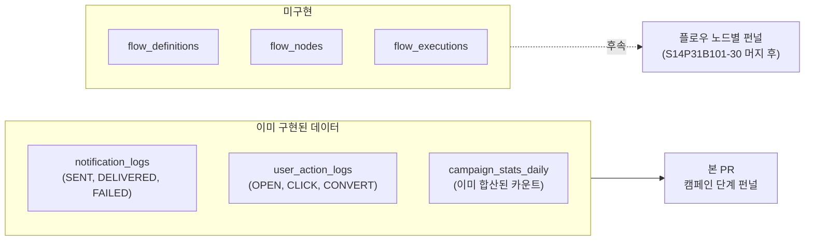
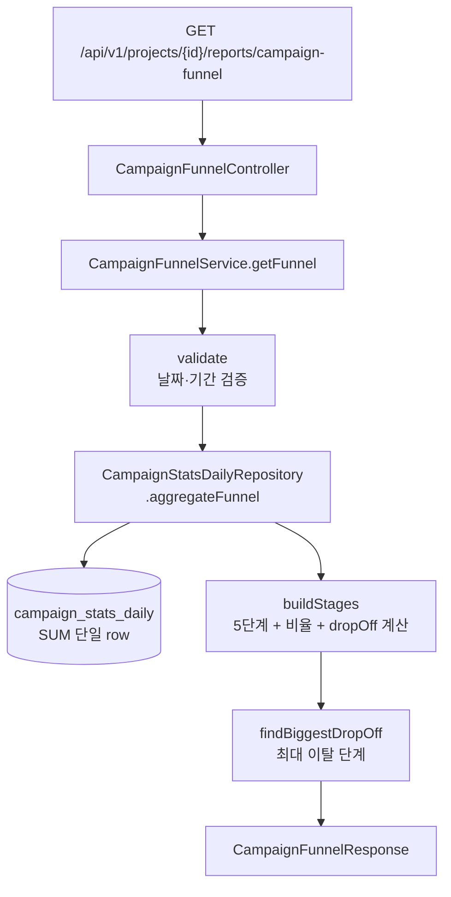

# 캠페인 단계 펀널 리포트 — 학습 노트

> **대상**: butterfly 팀 백엔드/프론트엔드 (펀널 분석 개념을 익히면서 본 PR을 따라가고 싶은 팀원)
> **티켓**: [S14P31B101-90](https://ssafy.atlassian.net/browse/S14P31B101-90)
> **작성**: 2026-05-07 / 작성자: 이재영

이 문서는 "왜 이 형태의 펀널 API를 만들었는가"를 설명한다. 코드를 읽기 전에 의사결정 흐름을 이해할 수 있다.

---

## 1. 펀널이란

**여러 단계를 거쳐야 하는 행동에서, 각 단계마다 얼마나 사람이 빠지는지(drop-off)를 보는 분석**.

```
SENT (1000명)         ████████████████████  100%
   ↓ 20% 이탈
DELIVERED (800명)     ████████████████      80%
   ↓ 50% 이탈
OPEN (400명)          ████████              40%
   ↓ 75% 이탈  ← 가장 큰 누수
CLICK (100명)         ██                    10%
   ↓ 75% 이탈
CONVERT (25명)        █                     2.5%
```

각 화살표가 가리키는 숫자가 **drop-off rate**이다. 마케터는 이 그래프만 보고 "오픈은 잘 일어나는데 클릭이 안 일어난다 → 문구를 바꿔야겠다"고 결정할 수 있다.

---

## 2. 본 PR의 스코프 — 왜 "캠페인" 펀널인가

기획서 11-10은 본래 **자동화 플로우 노드별 펀널**을 요구한다.
> 트리거 → 대기 → 분기 → 발송 → ... 같은 플로우 노드를 거치면서 어디서 빠지는지

그런데 자동화 플로우 도메인(S14P31B101-30)이 **아직 미구현**이다. flow_definitions·flow_nodes·flow_executions 같은 테이블이 없다. 그래서 본 PR은 **이미 있는 데이터로 의미 있는 펀널을 먼저 제공**하는 쪽으로 스코프를 축소했다.



**이게 절충안인 이유**:
- 데이터/엔진은 이미 있어서 추가 마이그레이션 0건
- 마케터가 즉시 쓸 수 있는 의미 있는 분석 (캠페인 발송 lifecycle drop-off도 운영에서 매우 자주 보는 지표)
- 자동화 플로우가 추가되면 같은 SPI 패턴으로 확장 (본 코드 그대로 → 노드별 펀널만 추가)

---

## 3. 5단계 정의

| 단계 | 의미 | 출처 컬럼 |
|---|---|---|
| **SENT** | 발송 시도 (워커가 메시지를 외부로 내보냄) | `campaign_stats_daily.sent_count` |
| **DELIVERED** | 사용자 단말까지 도달 | `delivered_count` |
| **OPEN** | 사용자가 메시지를 봄 | `open_count` |
| **CLICK** | 메시지 안 링크/버튼 클릭 | `click_count` |
| **CONVERT** | 클라이언트 정의 전환 행동 (구매·가입 등) | `convert_count` |

각 단계는 **이전 단계가 일어난 후에야 가능**하다. 도달 안 한 메시지는 오픈할 수 없고, 오픈 안 한 메시지는 클릭할 수 없다. 이 시퀀스가 펀널을 의미 있게 만든다.

---

## 4. 비율 3종 — 무엇을 보는가

각 단계마다 3가지 비율이 응답에 들어간다.

### 4.1 conversionFromStart — 시작 단계 대비

> "처음 발송된 1000건 중 이 단계까지 살아남은 비율"

```
DELIVERED 80% (start 대비) — 1000건 중 800건이 전달됨
OPEN      40% (start 대비) — 1000건 중 400건이 열림
```

마케팅 캠페인 전체 효율을 한 줄로 본다.

### 4.2 conversionFromPrev — 직전 단계 대비

> "직전 단계까지 살아남은 사람 중 이 단계로 진행한 비율"

```
DELIVERED 80% (prev: SENT) — 발송한 1000건 중 800건 전달
OPEN      50% (prev: DELIVERED) — 전달된 800건 중 400건 오픈
CLICK     25% (prev: OPEN) — 오픈한 400건 중 100건 클릭
```

각 단계의 **국소 효율**을 본다. "오픈된 사람은 잘 클릭하는가?" 같은 질문에 답한다.

### 4.3 dropOffFromPrev — 직전 단계 대비 이탈률

`100 - conversionFromPrev`. 단순 변환이지만 UI에서 "여기서 X%가 빠졌다" 같은 빨간색 표시에 직접 쓸 수 있다.

### 4.4 왜 두 가지 비율을 모두 주는가

하나만 주면 두 종류 의사결정 중 하나를 답할 수 없다.

- **start 대비만**: "전체 효율은 알겠는데, 어느 단계가 비효율의 원인인지 모름". 모든 단계가 다 줄어들기 때문에 어디가 문제인지 안 보임.
- **prev 대비만**: "이번 단계는 잘 되는데, 이게 절대량 기준으로 의미 있는지 모름". 100명 중 90명이 클릭해도 그 100명이 1000명 시작 중 100명이라면 결국 별로인데 그 맥락이 사라짐.

둘 다 함께 보면 "DELIVERED→OPEN 통과율은 50%로 나쁘지 않은데, OPEN→CLICK이 25%로 급격히 떨어짐. 여기가 진짜 문제 단계."처럼 추론이 가능.

---

## 5. biggestDropOffStage — 빠른 인사이트

응답에 한 필드가 더 들어간다 — 직전 단계 대비 이탈률이 **가장 큰 단계**의 식별자.

```json
{
  "stages": [...],
  "biggestDropOffStage": "CLICK"   // OPEN→CLICK에서 75% 이탈
}
```

**왜 별도 필드로 빼는가**: 클라이언트가 stages 배열을 매번 정렬해서 max를 찾는 건 낭비. 서버가 한 번 계산해 주면 UI는 "여기가 누수입니다" 카드를 즉시 띄울 수 있다.

**계산 규칙**:
- 첫 단계(SENT)는 후보에서 **제외** — SENT는 자기 자신 대비라 항상 dropOff=0
- dropOff가 null인 단계도 제외 (분모 0이라 비율 계산 불가)
- 동률이면 먼저 발견된 단계 (현재 구현은 `>` 비교라 동률 시 인덱스 작은 쪽 = 펀널 앞쪽)

---

## 6. 분모 0 처리 — KPI 정의서 §3 따름

`delivered_count = 0`이면 OPEN의 직전 대비 비율을 계산할 수 없다 (0으로 나눔). 모든 비율 계산은 다음 규칙을 따른다.

```java
private static BigDecimal ratePercent(long numerator, long denominator) {
    if (denominator == 0) {
        return null;  // KPI 정의서 §3 — 분모 0이면 비율 정의 불가
    }
    return BigDecimal.valueOf(numerator)
            .multiply(HUNDRED)
            .divide(BigDecimal.valueOf(denominator), RATE_SCALE, RoundingMode.HALF_UP);
}
```

JSON에서는 `null`로 직렬화. 클라이언트는 `null`을 "데이터 부족"으로 표시 (예: "—")해야 한다.

**대안과 트레이드오프**:
- `0%`로 표시? → 잘못된 신호. "이 단계는 0%다"와 "이 단계는 계산 불가다"는 다름.
- `100%`로 표시? → 분자가 0인 케이스에서만 그렇고 우연. 일관성 없음.
- `null`로 명시 → 클라이언트가 의도적으로 처리해야 함. 본 프로젝트의 모든 비율 지표가 이 규칙.

---

## 7. 코드 투어



**한 번의 SQL로 5단계 모두**: `aggregateFunnel`은 SUM 한 번으로 sent/delivered/open/click/convert 카운트를 묶어 가져온다. 단계마다 별도 쿼리하면 DB round-trip이 5배가 되니, 단일 합산이 옳다.

**파일 매핑**:
- [CampaignFunnelController.java](../src/main/java/com/b101/butterfly/reporting/report/controller/CampaignFunnelController.java) — HTTP
- [CampaignFunnelService.java](../src/main/java/com/b101/butterfly/reporting/report/service/CampaignFunnelService.java) — 비즈니스 로직
- [CampaignStatsDailyRepository.aggregateFunnel](../src/main/java/com/b101/butterfly/reporting/aggregation/repository/CampaignStatsDailyRepository.java) — JPQL
- DTO 6개 ([report/dto/](../src/main/java/com/b101/butterfly/reporting/report/dto/))

---

## 8. 92(세그먼트×채널 매트릭스)와의 차이

같은 디렉토리(`report/`)에 같은 데이터(`campaign_stats_daily`)를 쓰지만 답하는 질문이 다르다.

| 질문 | API |
|---|---|
| "어느 segment-channel 조합이 효율적인가?" (가로 비교) | 92 (segment-channel matrix) |
| "한 캠페인의 단계마다 어디서 빠지나?" (세로 흐름) | 90 (campaign funnel) |

92는 그룹별 효율 비교, 90은 시퀀스 drop-off. 둘 다 보면 "VIP × PUSH가 효율 1위(92) → 그런데 그 VIP × PUSH 내에서도 OPEN→CLICK이 약함(90)" 같은 종합 인사이트가 나온다.

---

## 9. 한계와 후속 작업

### 9.1 본 PR이 다루지 않는 것

- **자동화 플로우 노드별 펀널**: S14P31B101-30 머지 후 후속 티켓에서 추가
- **이탈 고객 드릴다운**: 기획서에 있던 "노드 클릭 시 상세 이탈 고객 목록"은 user 단위 anti-join이 필요해 별도 작업
- **세그먼트 필터**: 매트릭스(92)와 달리 본 펀널은 segmentId 필터가 없음 — 캠페인이 이미 단일 세그먼트에 묶이므로 campaignId 필터로 충분하다는 판단. 멀티세그먼트 캠페인이 도입되면 추가 검토.
- **시계열 비교**: "주간/월간 추이"는 별도 series API가 필요 — 본 PR은 단일 기간 합산.
- **CSV 내보내기**: 91번 공통 CSV 컴포넌트가 들어오면 같이 통합

### 9.2 알려진 제약

- 1년치(366일) 초과 조회는 거부 — 운영 보호. SLA 측정 후 더 늘려도 됨.
- biggestDropOff 동률 시 펀널 앞쪽 우선 — 일관된 결과를 위해 의도된 결정 (아래쪽이 더 의미 있을 수도 있지만, 대부분의 경우 앞쪽이 더 큰 절대량 손실).

---

## 10. 더 읽을 거리

- KPI 정의서: `backend/docs/operations/kpi-and-attribution.md` §3 (비율 지표 분모 0 정책)
- 92번 매트릭스 학습 노트: [세그먼트×채널 매트릭스](./learning_kafka_dlq_retry.md) (스타일 참고용)
- 일반 자료 — 펀널 분석:
  - "Funnel analysis" (Wikipedia)
  - Mixpanel/Amplitude 같은 분석 도구의 funnel 화면 — UI 레퍼런스로 좋음
