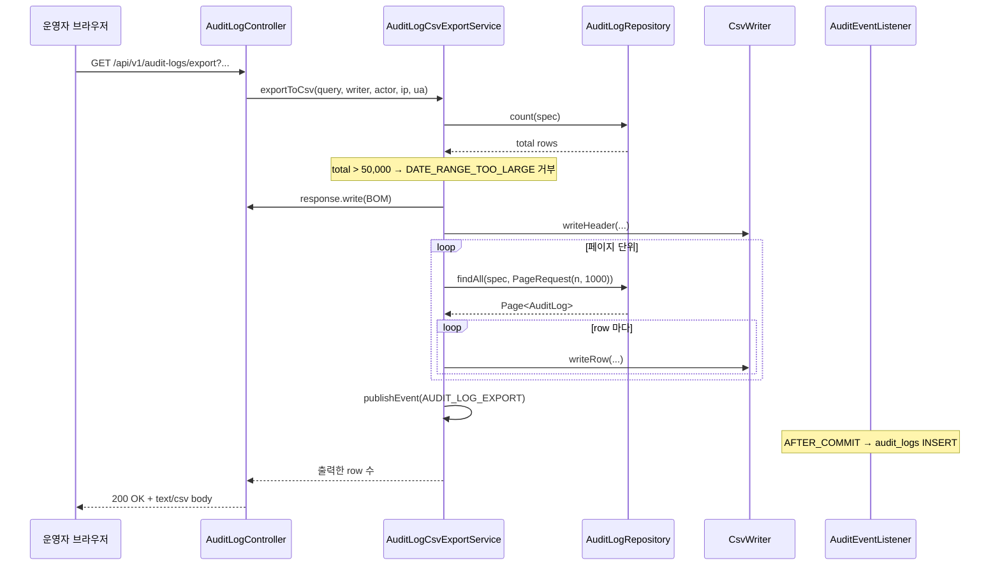
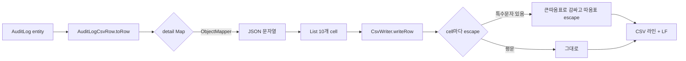

# 감사 로그 CSV 내보내기 + 공용 CsvWriter — 학습 노트

> **대상**: butterfly 팀 백엔드 (CSV 출력 / streaming / RFC 4180 / 자체 audit 패턴을 익히고 싶은 팀원)
> **티켓**: [S14P31B101-91](https://ssafy.atlassian.net/browse/S14P31B101-91), [S14P31B101-35](https://ssafy.atlassian.net/browse/S14P31B101-35)
> **작성**: 2026-05-07 / 작성자: 이재영

이 문서는 "왜 이렇게 만들었는가"를 설명한다. 작은 기능처럼 보여도 의외로 결정 포인트가 많아서 나중에 다른 도메인이 같은 패턴을 도입할 때 재현 가능하게 정리한다.

---

## 1. 문제 정의

기획서 11-10 + 화면설계서 SCR-009 — 운영자가 감사 로그/리포트 데이터를 외부 도구·감사 제출용으로 **CSV로 반출**할 수 있어야 한다.

표면상 단순 작업처럼 보이지만 다음을 동시에 만족해야 한다:

1. **Excel에서 한글이 깨지지 않는다** — 한국 환경 필수
2. **데이터에 쉼표·따옴표·줄바꿈이 들어 있어도 안전** — 공격성 데이터든 실수든
3. **수만 row를 메모리에 한 번에 안 올린다** — 스파이크 시 OOM 위험
4. **"누가 언제 무엇을 반출했는가"가 자체 audit으로 남는다** — 보안/감사 증적
5. **다른 리포트(34/92/90)도 같은 컴포넌트 재사용** — 91이 공용 컴포넌트 티켓

이 5가지가 코드에서 어떻게 풀렸는지를 따라가는 게 본 문서의 목표다.

---

## 2. 전체 흐름 한눈에 보기



핵심 포인트:
- **응답 헤더 → BOM → 헤더 row → 데이터 row → 자체 audit 이벤트** 순서
- 서비스가 count로 임계 검사 후, 페이지 단위로 읽어 즉시 writer로 흘려보낸다
- 응답 끝나기 전에 audit 이벤트를 publish — listener가 AFTER_COMMIT에 INSERT

---

## 3. 5개 결정 포인트 — 왜 이렇게 했나

### 3.1 RFC 4180 이스케이프 — 직접 구현 vs 라이브러리

대안 후보:
- Apache Commons CSV
- OpenCSV
- 직접 구현

**결정: 직접 구현**

이유:
- 이스케이프 규칙이 단순 (3종 특수문자만): `,` `"` 줄바꿈
- 의존성을 추가하면 다른 도메인까지 전파됨 — 단순 작업에 dep 추가는 과함
- 본 PR의 `CsvWriter`는 90줄 — 라이브러리 학습 곡선이 더 비쌈

```java
static String escape(String value) {
    if (value == null) return "";
    boolean needsQuote = value.indexOf(',') >= 0
            || value.indexOf('"') >= 0
            || value.indexOf('\n') >= 0
            || value.indexOf('\r') >= 0;
    if (!needsQuote) return value;
    StringBuilder sb = new StringBuilder(value.length() + 4);
    sb.append('"');
    for (int i = 0; i < value.length(); i++) {
        char c = value.charAt(i);
        if (c == '"') sb.append('"').append('"');  // "" 로 escape
        else sb.append(c);
    }
    sb.append('"');
    return sb.toString();
}
```

요점:
- **needsQuote 검사 후에만 감싸기** — 평문 row는 따옴표 없이 출력해 파일 크기 최소화
- **따옴표는 두 번 (`""`) 이스케이프** — RFC 4180 §2.7
- **null → 빈 문자열** — 직렬화 결과의 일관성을 위해

### 3.2 UTF-8 BOM — 왜 박는가, 어디에 박는가

Excel은 CSV를 열 때 **인코딩 자동 감지가 약하다**. UTF-8로 저장돼 있어도 시스템 default(한국어 Windows에서 CP949)로 해석해 한글이 깨진다.

해결책: **파일 첫 3바이트에 UTF-8 BOM(`EF BB BF`) 박기**. Excel이 BOM을 보면 UTF-8로 강제 인식.

```java
public static final String UTF8_BOM = "";

// 응답 본문 첫 출력
out.write(UTF8_BOM);
csv.writeHeader(...);
```

**왜 헤더가 아니라 본문에?** Content-Type: `charset=UTF-8`만으로는 Excel이 무시한다. 본문 byte로 명시해야 Excel이 받아들임.

**왜 CsvWriter가 아니라 Service에서?** CsvWriter는 RFC 4180 직렬화만 책임 — BOM은 transport(HTTP body)의 결정. 한 번 원칙을 정해서 분리해두면 나중에 파일/Kafka 등 다른 sink에서도 BOM 정책을 별도로 바꿀 수 있다.

### 3.3 동기 streaming vs 비동기 202 Accepted

명세서에 둘 다 언급되어 있다. 본 PR은 **동기 streaming만**, 비동기는 후속.

이유:
- 비동기 202는 인프라 의존성이 큼: 작업 큐, 임시 파일 스토리지, 알림 채널, 폴링 또는 WebSocket
- MVP 트래픽 예상은 1만~5만 row 정도 — 동기로 1~3초면 처리됨
- 임계(50,000 row) 초과 시 거부로 시스템 보호 충분

페이지 streaming 패턴:
```java
private long streamPages(Specification<AuditLog> spec, CsvWriter csv) throws IOException {
    long written = 0;
    int pageNumber = 0;
    while (true) {
        final int currentPage = pageNumber;
        Page<AuditLog> page = transactionTemplate.execute(status ->
                auditLogRepository.findAll(spec,
                        PageRequest.of(currentPage, STREAMING_PAGE_SIZE,
                                Sort.by(Sort.Direction.DESC, "createdAt"))));
        if (page == null || page.isEmpty()) break;
        for (AuditLog row : page.getContent()) {
            csv.writeRow(AuditLogCsvRow.toRow(row, objectMapper));
            written++;
        }
        if (!page.hasNext()) break;
        pageNumber++;
    }
    return written;
}
```

요점:
- **페이지마다 짧은 트랜잭션** — 5만 row를 한 트랜잭션으로 잡으면 long-running read tx가 됨
- **결과를 List에 담지 않고 바로 writer로** — 메모리에 1000개씩만 올라감
- **`final int currentPage`로 람다 캡처 회피** — 외부 변수 직접 캡처 시 컴파일 에러

### 3.4 자체 Audit — `AUDIT_LOG_EXPORT`

CSV 다운로드 자체가 **민감 데이터 반출**이므로 audit 대상이다. 누가 언제 어떤 필터로 몇 건을 반출했는가가 audit_logs에 기록되어야 한다.

ADR-0009의 도메인 이벤트 패턴 그대로 사용:
```java
private final ApplicationEventPublisher eventPublisher;

private void publishExportAudit(...) {
    AuditRecordedEvent event = AuditRecordedEvent.of(
            query.projectId(), actorMemberId,
            EXPORT_ACTION,           // "AUDIT_LOG_EXPORT"
            "AuditLog", null,
            ipAddress, userAgent, detail
    );
    transactionTemplate.executeWithoutResult(status -> eventPublisher.publishEvent(event));
}
```

**왜 트랜잭션 안에서 publish?** `AuditEventListener`는 `@TransactionalEventListener(phase = AFTER_COMMIT)`이라 **현재 트랜잭션이 commit돼야** 호출된다. CSV 응답 자체는 read-only면서 트랜잭션을 안 잡고 있을 수 있어서, publish 시점에만 짧은 트랜잭션을 열어 commit한다.

**만약 publish가 실패하면?** AFTER_COMMIT listener의 예외는 발행자에게 전파되지 않는다. 즉 자체 audit 실패가 CSV 응답을 깨지 않는다 — 이게 정상 동작이다 (audit이 비즈니스 로직을 깨뜨리면 안 됨).

### 3.5 actor 식별 — `X-Member-Id` 헤더

본 PR은 auth 모듈 합류 전이라 다른 컨트롤러와 동일한 임시 패턴 사용:
```java
@RequestHeader("X-Member-Id") Long actorMemberId
```

추후 `@AuthenticationPrincipal`로 한 번에 교체 예정 — `SegmentController` 등 다른 컨트롤러도 같은 변환을 받을 것이라 일관성 유지.

`actorMemberId == null`인 경우 self-audit 스킵 (방어):
```java
if (actorMemberId == null) {
    log.warn("audit log export without actor — skipped self-audit");
    return;
}
```

운영상 발생할 일은 없지만 (filter가 X-Member-Id 없으면 401), 테스트/잘못된 호출 시 NPE보다 무시 + 로그가 안전.

---

## 4. 데이터 흐름 — 한 row가 어떻게 CSV 한 줄이 되는가



**컬럼 순서 결정**: 명세서 #20 응답 필드 순서 그대로:
```
auditId, projectId, memberId, action, targetType, targetId,
ipAddress, userAgent, createdAt, detail
```

**detail 컬럼 처리**: Map → JSON 문자열로 직렬화 → CSV escape. JSON 안의 따옴표가 `""`로 두 번 escape됨:
```
"{""hashPrefix"":""a1b2c3d4""}"
```

읽는 도구가 CSV escape를 풀면 `{"hashPrefix":"a1b2c3d4"}`로 복원된다.

---

## 5. 코드 투어 — 4개 클래스만 보면 됨

| 파일 | 역할 | 줄 수 |
|---|---|---|
| [CsvWriter](../src/main/java/com/b101/butterfly/reporting/export/CsvWriter.java) | RFC 4180 직렬화 (도메인 무관 공용) | ~90 |
| [AuditLogCsvRow](../src/main/java/com/b101/butterfly/reporting/audit/service/AuditLogCsvRow.java) | AuditLog → List<String> 변환 | ~70 |
| [AuditLogCsvExportService](../src/main/java/com/b101/butterfly/reporting/audit/service/AuditLogCsvExportService.java) | streaming + 임계 검사 + self-audit 발행 | ~190 |
| [AuditLogController.exportCsv](../src/main/java/com/b101/butterfly/reporting/audit/controller/AuditLogController.java) | HTTP 헤더 + writer 전달 | ~50 |

**역할 분리**:
- **CsvWriter는 도메인을 모른다** — `List<String>`만 받는다. 다른 도메인이 그대로 가져다 쓸 수 있다.
- **AuditLogCsvRow는 audit 도메인 전용** — entity → cells 변환만 담당.
- **Service는 모든 비즈니스 정책** — 임계, 페이지 streaming, self-audit, 트랜잭션.
- **Controller는 transport** — HTTP 헤더, BOM 출력, writer 전달.

새 리포트(예: 캠페인 성과 CSV)가 추가될 때:
- ✅ CsvWriter 그대로 재사용
- ✅ Service의 streaming 패턴 복사 (10여 줄)
- ✅ self-audit 발행 패턴 복사 (action 코드만 변경: `CAMPAIGN_REPORT_EXPORT`)
- ➕ 새 RowMapper 1개 작성

---

## 6. 한계와 후속 작업

### 6.1 본 PR이 다루지 않는 것

- **비동기 202 Accepted** — 50,000 row 초과 거부로 회피. 후속 티켓에서 작업 큐 도입.
- **다른 리포트 CSV** — 91번 명세에 34/92/90도 포함됐지만 본 PR에선 audit만. CsvWriter 도입했으니 나머지는 짧은 후속.
- **임시 파일 보관소** — 비동기 패턴이 들어와야 의미 있음.
- **다운로드 알림** (WebSocket/이메일) — 비동기 패턴과 함께.

### 6.2 알려진 제약

- **50,000 row 임계는 추정치** — 운영 트래픽 측정 후 조정. 메모리/응답 시간 기준으로.
- **페이지 정렬 키가 createdAt DESC만** — 사용자 정렬은 미지원. 합리적 기본값.
- **detail JSON 직렬화 실패 시 빈 문자열 fallback** — 부분적 데이터 손실 가능. ObjectMapper가 Map<String, Object>를 못 직렬화할 케이스는 거의 없지만 방어선.

### 6.3 후속 권장

| 후속 | 트리거 |
|---|---|
| 캠페인 성과 CSV (S14P31B101-34와 함께) | 34 진행 시 |
| 매트릭스(92)/펀널(90) CSV | 별도 sprint |
| 비동기 202 패턴 | 임계 부족 케이스 등장 시 |
| `AsyncReportExportJob` 인프라 | 비동기 도입 시 |

---

## 7. 더 읽을 거리

- RFC 4180 (Common Format and MIME Type for CSV Files): https://datatracker.ietf.org/doc/html/rfc4180
- ADR-0009 — 도메인 이벤트 + AuditEventListener 패턴
- 90 학습 노트 [learning_campaign_funnel.md](./learning_campaign_funnel.md) — 같은 reporting/report 패키지의 SUM 쿼리 패턴
- 180 학습 노트 [learning_kafka_dlq_retry.md](./learning_kafka_dlq_retry.md) — 도메인 이벤트 + AFTER_COMMIT listener 활용 다른 사례
