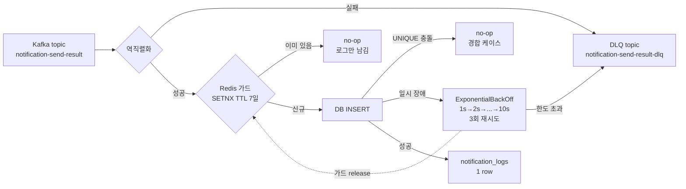
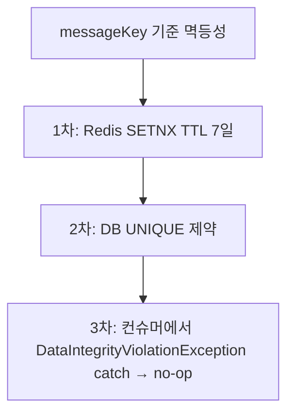
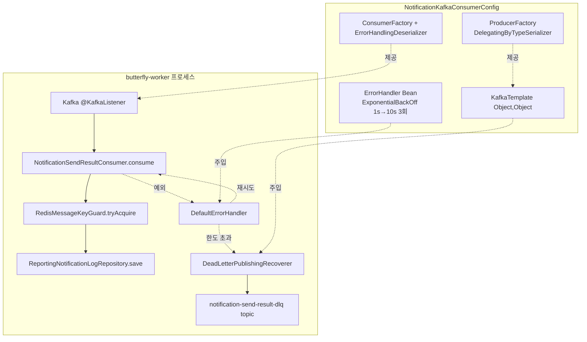
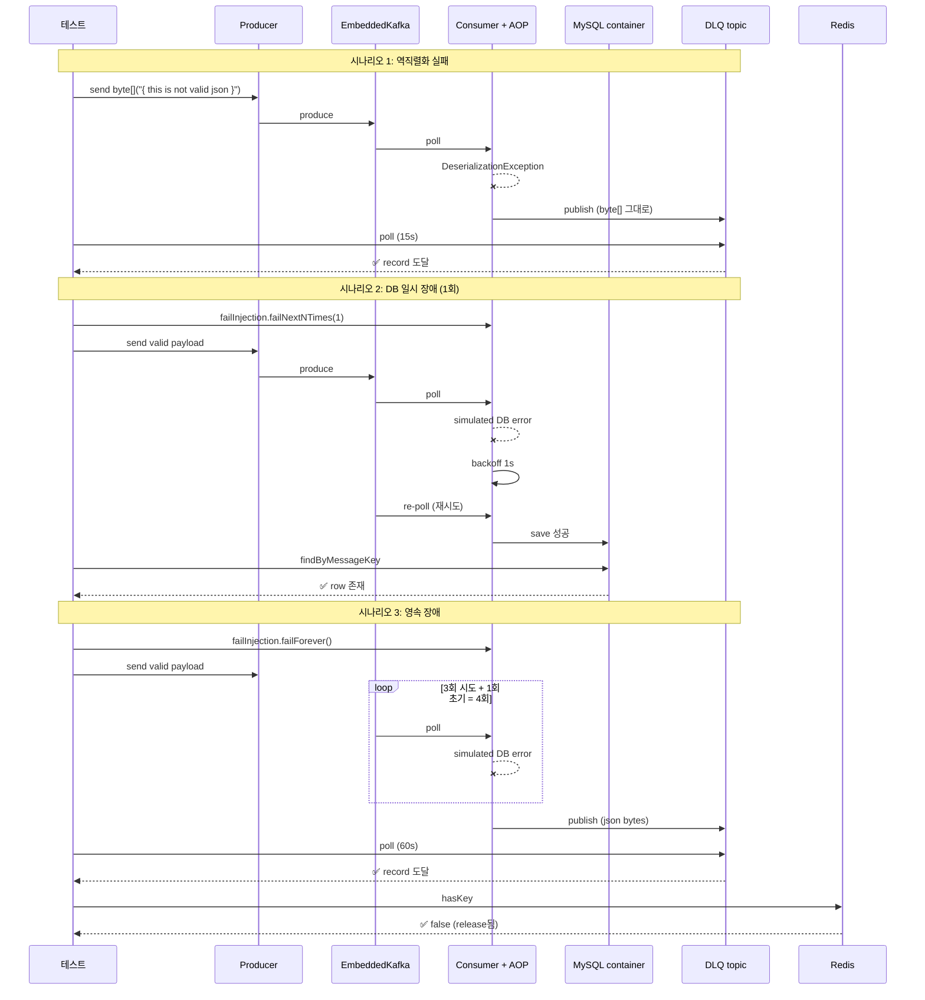

# Kafka 컨슈머 DLQ + 재시도 + 보조 멱등성 — 학습 노트

> **대상**: butterfly 팀 백엔드 엔지니어 (Spring Kafka에 익숙하지 않은 팀원 포함)
> **티켓**: [S14P31B101-180](https://ssafy.atlassian.net/browse/S14P31B101-180)
> **작성**: 2026-05-07 / 작성자: 이재영

이 문서는 "왜 이렇게 만들었는가"를 설명한다. 코드를 보고도 의도가 명확하지 않은 부분의 결정 배경을 따라갈 수 있게 한다.

---

## 1. 문제 정의

`notification-send-result` 토픽으로 발송 워커(이서연/구동엽 팀)가 발행한 메시지를 reporting이 소비해 `notification_logs`에 적재한다. 단순 INSERT만 하면 다음 상황에서 무너진다.

- **파싱 실패 메시지**가 들어오면 컨슈머가 같은 offset에서 무한 루프
- **DB가 일시적으로 죽으면** (예: 페일오버 30초) 메시지가 그냥 사라지거나 무한 재시도
- **같은 메시지가 두 번 들어오면** 중복 적재 (Kafka는 at-least-once 보장이라 흔함)

`S14P31B101-177`(122-A2)에서 컨슈머 골격만 만들었고, 이 위에 운영 안정성 3종 세트를 얹는 게 본 작업이다.

---

## 2. 해결 전략 한눈에 보기



세 가지 방어선이 있다.
1. **DLQ + 재시도**: 메시지 자체나 인프라 문제에 대응
2. **Redis 가드**: 같은 messageKey를 두 번 처리하지 않게 1차 차단
3. **DB UNIQUE 제약**: Redis가 죽거나 우회된 경우 최종 방어

---

## 3. 핵심 개념 미니 강의

### 3.1 DLQ (Dead Letter Queue)

처리 못 하는 메시지를 **별도 토픽으로 격리**해 컨슈머 루프를 살리는 패턴이다. 운영자가 나중에 DLQ를 꺼내 보고 원인 분석 + 수동 재처리할 수 있다.

| 안 쓰면 | 쓰면 |
|---|---|
| 깨진 메시지 1건이 컨슈머 전체를 멈춤 (head-of-line blocking) | 깨진 메시지만 격리, 나머지는 정상 진행 |
| 메시지가 무한 루프 → CPU/로그 폭주 | 한도 후 DLQ로 빠짐, 시스템 안정 |

**우리 구현**: `DefaultErrorHandler` + `DeadLetterPublishingRecoverer`. Spring Kafka가 record의 토픽 이름에 `-dlq`를 붙여서 새 토픽으로 발행한다. 원본 메시지의 헤더에 `kafka_dlt-exception-message`, `kafka_dlt-exception-stacktrace` 등 디버깅 정보가 자동으로 붙는다.

### 3.2 지수 백오프 재시도

DB가 5초간 죽었다가 살아난다면, 즉시 3번 재시도하면 다 실패한다. 점점 간격을 늘리면 회복 시간을 벌어준다.

```
시도 1 (즉시 실패)
  ↓ 1초 대기
시도 2 (실패)
  ↓ 2초 대기
시도 3 (실패)
  ↓ 4초 대기
시도 4 (실패) → DLQ로
```

**왜 3회?** 명세서 권장치이자 일반적 SLA. 너무 적으면 일시 장애도 못 견디고, 너무 많으면 컨슈머 lag이 누적된다. `MaxInterval=10s`로 한 번에 너무 오래 자지 않게 캡을 둔다.

**중요**: `DefaultErrorHandler`의 백오프는 **같은 컨슈머 스레드에서 blocking**된다. 그래서 재시도 동안 같은 partition의 다른 메시지가 처리 못 됨 → 짧고 강한 재시도가 적합. 더 긴 대기가 필요하면 `RetryTopicConfiguration` (non-blocking, 별도 retry topic) 패턴을 쓴다. 우리는 DB 일시 장애 시나리오만 겨냥하므로 blocking 3회면 충분.

### 3.3 멱등성 (Idempotency)

같은 메시지가 두 번 들어와도 결과가 같아야 한다. Kafka는 **at-least-once** 보장이라 컨슈머 재시작/리밸런스 시 동일 메시지 재소비가 일상이다.

3중 방어:



**왜 Redis까지?** DB UNIQUE만으로도 정확성은 보장되지만, 모든 중복 메시지가 DB까지 가서 예외를 발생시키면 부하다. Redis는 메모리에서 ms 단위로 차단하니 중복이 많은 시점에 DB를 보호한다.

**TTL을 7일로 둔 이유**: Kafka의 retention(통상 7일)과 정합. retention보다 짧으면 retention 안에서 재소비 시 중복 차단을 못 한다. 길게 둬도 메모리 사용만 늘 뿐 의미 없다.

### 3.4 fail-open vs fail-closed

Redis가 죽으면 가드 호출은 실패한다. 두 가지 선택:
- **fail-closed**: Redis 실패 시 메시지 처리 거부 → 데이터 정확하지만 가용성 낮음
- **fail-open**: Redis 실패 시 메시지 통과 → DB UNIQUE에 위임, 정확성도 OK

우리는 **fail-open**을 선택. Redis는 어디까지나 보조 방어선이고, 본 정확성은 DB가 담당한다.

```java
// RedisMessageKeyGuard.java
public boolean tryAcquire(String messageKey) {
    try {
        Boolean acquired = redisTemplate.opsForValue()
                .setIfAbsent(KEY_PREFIX + messageKey, "1", TTL);
        return Boolean.TRUE.equals(acquired);
    } catch (RuntimeException e) {
        log.warn("Redis guard fail-open messageKey={} reason={}", messageKey, e.getMessage());
        return true;  // 통과시킴
    }
}
```

---

## 4. 설계 결정과 트레이드오프

### 4.1 왜 `RetryTopicConfiguration` (non-blocking) 안 썼나?

| 기준 | DefaultErrorHandler (선택) | RetryTopicConfiguration |
|---|---|---|
| 구현 복잡도 | 낮음 (Bean 1개 추가) | 높음 (retry topic N개 + producer 추가) |
| 토픽 수 | 1 (원본) + 1 (DLQ) | 1 + N(retry) + 1(DLQ) |
| 메시지 순서 | 같은 partition 내 보장 | 깨짐 (retry topic 경유로 늦게 처리됨) |
| blocking 여부 | partition blocking O | non-blocking |
| 적합한 시나리오 | 짧은 재시도 (초 단위) | 긴 재시도 (분/시간 단위) |

DB 일시 장애는 보통 초 단위로 회복되고, partition 1개가 짧게 blocking되는 비용을 감수할 만하다. 명세서에서도 "또는"으로 둘 다 옵션으로 제시했지만 단순함을 택함.

### 4.2 왜 `DelegatingByTypeSerializer`인가?

DLQ로 보낼 때 record의 value는 두 종류로 들어온다.
- **역직렬화 실패 케이스**: 원본 byte[] (Spring Kafka가 그대로 넘김)
- **DB 장애 한도 초과 케이스**: 정상 역직렬화된 객체 → 다시 직렬화 필요

```java
// 단일 ProducerFactory에서 타입별로 다른 serializer 사용
Map<Class<?>, Serializer<?>> valueDelegates = new HashMap<>();
valueDelegates.put(byte[].class, new ByteArraySerializer());
valueDelegates.put(String.class, new StringSerializer());
factory.setValueSerializer(new DelegatingByTypeSerializer(valueDelegates, true));
```

처음엔 byte[] 전용 ProducerFactory만 만들었는데, 정상 역직렬화된 객체 case에서 `ClassCastException: java.lang.String cannot be cast to class [B`로 깨졌다. 이게 통합 테스트가 잡아낸 핵심 버그.

### 4.3 왜 가드를 release하는가?

```java
} catch (RuntimeException e) {
    messageKeyGuard.release(messageKey);
    throw e;
}
```

DB 장애로 INSERT가 실패하면 메시지는 ErrorHandler가 잡아 재시도한다. 재시도 시 같은 메시지가 다시 컨슈머에 들어오는데, 이때 Redis 가드가 점유 상태이면 가드에서 차단되어 영원히 적재 못 한다. 그래서 실패 시 가드를 풀어준다.

**중복 INSERT 케이스(`DataIntegrityViolationException`)는 release하지 않는다.** 이미 다른 트랜잭션이 적재 성공한 케이스이므로 Redis 키도 그대로 유지하는 게 맞다.

### 4.4 어떤 예외를 즉시 DLQ로 보낼까?

```java
handler.addNotRetryableExceptions(
        DeserializationException.class,
        IllegalArgumentException.class,
        NullPointerException.class
);
```

기준: **재시도해도 결과가 같은 예외**.
- `DeserializationException`: 메시지 자체가 망가짐 → 100번 재시도해도 똑같이 실패
- `IllegalArgumentException`/`NullPointerException`: 코드 버그성 → 알리고 다음 메시지로 넘어가야 함

DB 장애(`DataAccessResourceFailureException`, `CannotAcquireLockException` 등)는 retryable.

`DataIntegrityViolationException`(UNIQUE 중복)은 컨슈머에서 catch해서 no-op 처리하므로 ErrorHandler까지 도달하지 않는다.

---

## 5. 코드 투어



**파일 매핑**:
- [NotificationKafkaConsumerConfig.java](../src/main/java/com/b101/butterfly/reporting/notification/config/NotificationKafkaConsumerConfig.java) — 빈 구성
- [NotificationSendResultConsumer.java](../src/main/java/com/b101/butterfly/reporting/notification/messaging/NotificationSendResultConsumer.java) — 비즈니스 로직
- [RedisMessageKeyGuard.java](../src/main/java/com/b101/butterfly/reporting/notification/messaging/RedisMessageKeyGuard.java) — 보조 멱등성

---

## 6. 통합 테스트가 어떻게 검증하는가

### 6.1 시나리오별 검증



### 6.2 Fail injection을 AOP로 한 이유

처음엔 `ReportingNotificationLogRepository`를 프록시로 감싸는 패턴을 썼다. 30개 메서드를 위임해야 해서 너무 무거웠고 Spring Data 인터페이스가 바뀌면 깨진다.

대안인 `@MockBean`은 Spring Boot 3.4부터 deprecated이고 컨텍스트 캐시 무효화 비용이 크다.

`@Aspect`로 컨슈머의 `consume()` 호출만 가로채서 인위적 예외를 던지는 방식이 가장 가볍다. 코드 변경 없이 테스트만의 행동 주입.

```java
@Around("execution(* com.b101.butterfly.reporting.notification.messaging.NotificationSendResultConsumer.consume(..))")
public Object aroundConsume(ProceedingJoinPoint pjp) throws Throwable {
    invocations.incrementAndGet();
    if (failForever) throw new DataAccessResourceFailureException("simulated DB outage");
    if (remainingFailures.getAndDecrement() > 0) throw new DataAccessResourceFailureException("simulated transient DB error");
    return pjp.proceed();
}
```

---

## 7. 디버깅 팁 — 통합 테스트 작성 중 만난 함정

### 7.1 KafkaTemplate 빈 충돌

`KafkaAutoConfiguration`은 `@ConditionalOnMissingBean(ProducerFactory.class)` 조건으로 default `kafkaTemplate`을 만든다. 우리가 DLQ용 ProducerFactory를 추가하니 default가 사라져 기존 테스트가 `NoSuchBeanDefinitionException`으로 깨졌다.

해결: 테스트에서 Spring 컨테이너 빈을 쓰지 말고 `EmbeddedKafkaBroker`로 직접 producer를 만든다.

```java
private void send(String topic, String key, NotificationSendResultPayload payload) {
    Map<String, Object> props = KafkaTestUtils.producerProps(embeddedKafkaBroker);
    props.put(ProducerConfig.KEY_SERIALIZER_CLASS_CONFIG, StringSerializer.class);
    props.put(ProducerConfig.VALUE_SERIALIZER_CLASS_CONFIG, JsonSerializer.class);
    try (Producer<String, NotificationSendResultPayload> p = new KafkaProducer<>(props)) {
        p.send(new ProducerRecord<>(topic, key, payload));
        p.flush();
    }
}
```

### 7.2 DLQ 발행 시 ClassCastException

원본 record의 key는 `String`이라 `ByteArraySerializer`로 직렬화하면 `ClassCastException` 발생. `DelegatingByTypeSerializer`로 분기하면 해결.

이 버그는 코드 리뷰만으로 안 잡힌다 — 통합 테스트가 실제 byte 변환을 거쳐서야 드러난다.

### 7.3 통합 테스트 태그

`@Tag("integration")`이 붙은 테스트는 default `test` 태스크에서 제외된다. `./gradlew :butterfly-reporting:integrationTest`로 실행해야 한다 (build.gradle:49-72에서 정의).

---

## 8. 한계와 후속 작업

### 8.1 본 PR이 다루지 않는 것

- **DLQ 자동 소비/재처리**: DLQ에 쌓인 메시지를 자동으로 다시 처리하는 별도 컨슈머는 없음. 현재는 운영자가 수동으로 꺼내 분석/재발행.
- **DLQ 모니터링**: DLQ 토픽 lag/메시지 수에 대한 알림은 별도 작업.
- **DLQ 토픽 자동 생성**: Kafka 브로커의 `auto.create.topics.enable=true` 가정. prod 환경에서는 사전 생성 권장.

### 8.2 운영 시 점검이 필요한 부분

- ExponentialBackOff `maxElapsedTime=20s`이므로 partition blocking이 최대 20초까지 누적될 수 있다. 트래픽 패턴에 따라 늘리거나 RetryTopicConfiguration으로 전환 검토.
- Redis 메모리: messageKey당 약 50바이트, TTL 7일. 1만 msg/s × 7일 ≈ 6GB 정도 추정. 실제 트래픽 측정 후 Redis 사이징 재검토.

### 8.3 다음 단계 (다른 티켓에서 다룰 가능성)

- **DLQ 재처리 도구**: Spring Cloud Stream의 `KafkaCustomEndpoints`나 자체 Admin API로 DLQ → 원본 토픽 re-publish
- **메트릭**: Micrometer로 retry count, DLQ 발행 수, Redis 가드 hit rate 노출
- **알림**: DLQ 메시지 발생 시 Slack/Email

---

## 9. 더 읽을 거리

- Spring Kafka 공식 — Error Handlers: https://docs.spring.io/spring-kafka/reference/kafka/annotation-error-handling.html
- Spring Kafka 공식 — Dead Letter Topic: https://docs.spring.io/spring-kafka/reference/kafka/annotation-error-handling.html#dead-letters
- Confluent — Idempotent Consumer pattern: https://www.confluent.io/blog/idempotent-kafka-consumers/
- ADR-0008 (본 프로젝트) — Append-only 3중 방어선 (유사한 다층 방어 사상)
