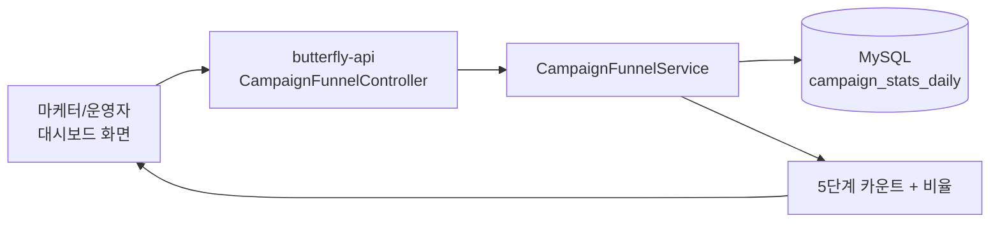
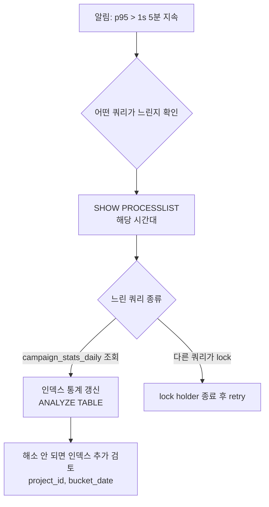

# 운영 인수 문서 — 캠페인 단계 펀널 리포트 API

> **대상**: SRE / 온콜 / DBA / PM (운영 관점에서 본 API의 가용성·성능·보안을 책임지는 사람)
> **시스템**: butterfly-api `/api/v1/projects/{projectId}/reports/campaign-funnel`
> **티켓**: [S14P31B101-90](https://ssafy.atlassian.net/browse/S14P31B101-90)
> **인수일**: 2026-05-07
> **소관 모듈**: butterfly-reporting (개발: 이재영)

---

## 1. 시스템 한 줄 요약

캠페인 발송 lifecycle 단계(SENT → DELIVERED → OPEN → CLICK → CONVERT)의 카운트와 단계간 통과율·이탈률을 합산해 반환하는 **읽기 전용 분석 API**. 데이터는 기존 집계 테이블 `campaign_stats_daily`를 사용하며 추가 마이그레이션·인프라 의존성은 없다.



쓰기 없음. 외부 의존(Kafka, Redis, 다른 도메인) 없음.

---

## 2. SLA / 운영 기준

| 항목 | 정상 기준 | 경보 임계 |
|---|---|---|
| API 응답 시간 (p95) | < 200ms | > 1s (5분 지속) |
| API 응답 시간 (p99) | < 500ms | > 2s (5분 지속) |
| 5xx 에러율 | < 0.1% | > 1% (1분 지속) |
| 4xx 에러율 (날짜 검증 등) | < 5% | > 20% (5분 지속, 클라이언트 버그 신호) |
| `campaign_stats_daily` 테이블 read latency (p95) | < 50ms | > 200ms |

본 API는 단일 SUM 쿼리 1회만 발생시킨다. p95가 1초를 넘으면 거의 항상 DB 부하 또는 인덱스 문제 신호.

---

## 3. 의존 인프라

| 항목 | 의존 종류 | 영향 |
|---|---|---|
| MySQL `campaign_stats_daily` | 필수 | 다운 시 5xx |
| Redis | 없음 | 본 API는 Redis 미사용 |
| Kafka | 없음 | 본 API는 Kafka 미사용 |
| 다른 도메인 (segment/campaign) | 없음 | SPI 의존도 본 PR 범위 외 |

**가장 큰 위험은 MySQL `campaign_stats_daily` 테이블의 데이터 가용성**. 일/시간 단위 합산 워커(S14P31B101-191)가 멈추면 본 API는 **응답은 200으로 정상이지만 카운트가 0**이 된다 (조용히 잘못된 응답). 별도 워커 헬스 모니터링 필요.

---

## 4. 데이터 소스

### 4.1 사용 컬럼

```sql
SELECT
  SUM(sent_count),
  SUM(delivered_count),
  SUM(open_count),
  SUM(click_count),
  SUM(convert_count)
FROM campaign_stats_daily
WHERE project_id = ?
  AND bucket_date BETWEEN ? AND ?
  AND (campaign_id = ? OR :campaignId IS NULL)
  AND (channel = ? OR :channel IS NULL)
```

### 4.2 권장 인덱스

기존 인덱스 활용:
- `uk_campaign_stats_daily_nat (campaign_id, channel, bucket_date)` — UNIQUE
- 추가로 `(project_id, bucket_date)` 인덱스가 있으면 본 API의 풀스캔 회피에 도움. **현재는 미설정** — 필요 시 별도 티켓.

쿼리 EXPLAIN 결과를 운영 적용 전에 한 번 검토 권장:
```sql
EXPLAIN SELECT SUM(sent_count), ... FROM campaign_stats_daily
WHERE project_id = 1 AND bucket_date BETWEEN '2026-04-01' AND '2026-04-30';
```
type이 `ALL`(풀스캔)이면 인덱스 추가 검토.

---

## 5. 응답 시간 예상 — Worst case

| 시나리오 | 예상 row 수 | 예상 응답 시간 |
|---|---|---|
| 단일 캠페인 + 단일 채널 + 7일 | 7 row | < 50ms |
| 프로젝트 전체 + 모든 채널 + 30일 | (캠페인 수 × 채널 수 × 30) row | < 200ms |
| 1년치 (366일) + 모든 채널 + 큰 프로젝트 | 수천 row | < 500ms (인덱스 있을 시) |

본 API의 입력 제한:
- 기간 367일 초과 거부 (`DATE_RANGE_TOO_LARGE`)
- 페이지네이션 없음 (응답이 항상 5단계로 작아서 의미 없음)

---

## 6. 모니터링

### 6.1 필수 메트릭

> **현재 상태**: Micrometer 기반 메트릭 노출은 본 PR에 포함 안 됨. 임시로 access log 분석으로 대체 후 별도 티켓에서 메트릭 추가.

| 메트릭 | 출처 | 임계 |
|---|---|---|
| `http_server_requests_seconds{uri="/api/v1/projects/*/reports/campaign-funnel"}` | Micrometer (TODO) | p95 > 1s |
| `http_server_requests_total{status=~"5.."}` | 동일 | rate > 0.001 |
| `http_server_requests_total{status="400",error_code="ANALYTICS_002"}` | 동일 | 클라이언트 검증 신호 |
| `http_server_requests_total{status="400",error_code="ANALYTICS_003"}` | 동일 | 너무 큰 기간 시도 — UI 검증 미흡 가능성 |

### 6.2 즉시 가용한 확인 방법

```bash
# 본 API 호출 빈도 확인 (access log)
docker logs butterfly-api 2>&1 | grep "campaign-funnel" | wc -l

# 5xx 에러 확인
docker logs butterfly-api 2>&1 | grep "campaign-funnel" | grep " 5[0-9][0-9] "

# 응답 시간 확인 (request 로그가 millis 포함 시)
docker logs butterfly-api 2>&1 | grep "campaign-funnel" | awk '{print $NF}' | sort -n | tail -10
```

---

## 7. 보안

### 7.1 권한

OWNER 권한 필수 (`@projectPermission.hasRole(#projectId, 'OWNER')`). projectId path variable에 본인 권한 없는 ID로 접근 시 `403`.

### 7.2 본 API가 노출하는 데이터

**개인정보 없음**. 합산된 카운트(정수)만 반환. 개별 user/device 식별자는 응답에 절대 포함되지 않음. 따라서 본 API는 GDPR/PII 등급에서 비교적 낮은 위험.

향후 "이탈 고객 드릴다운" 기능이 추가되면(별도 티켓) user_id 노출이 들어가니 그 시점에 다시 권한·로그 정책 재검토 필요.

### 7.3 감사 로그

본 API는 read-only이므로 audit_logs에 기록되지 않음 (audit_logs는 변경 행위 기록 전용). access log + 본 API 호출 빈도 모니터링으로 충분.

---

## 8. 장애 대응 런북

### 8.1 시나리오 — 응답 시간이 갑자기 증가



**Step 1 — 느린 쿼리 격리**:
```sql
SHOW FULL PROCESSLIST;
SELECT * FROM information_schema.innodb_trx;
```

**Step 2 — EXPLAIN으로 풀스캔 여부**:
```sql
EXPLAIN SELECT SUM(sent_count), SUM(delivered_count), SUM(open_count),
               SUM(click_count), SUM(convert_count)
FROM campaign_stats_daily
WHERE project_id = <문제 프로젝트>
  AND bucket_date BETWEEN '<from>' AND '<to>';
```

`type = ALL`이거나 `rows` 수치가 매우 크면 인덱스 부재. infra 팀과 합의 후 `(project_id, bucket_date)` 인덱스 추가.

**Step 3 — 임시 mitigation**:
- 본 API에 rate limit 적용 (`butterfly.ratelimit.endpoint-limits`에 항목 추가)
- 큰 기간 조회 차단 (현재 366일 → 30일 임시 축소)

### 8.2 시나리오 — 응답이 항상 0건 (모든 단계 count=0)

이건 본 API 자체 문제가 아니라 **선행 합산 워커 멈춤** 신호.

```bash
# campaign_stats_daily에 최근 데이터가 들어오고 있는지 확인
docker exec -it butterfly-mysql mysql -uroot -p butterfly -e \
  "SELECT MAX(updated_at) FROM campaign_stats_daily;"
```

`MAX(updated_at)`이 어제 이전이면 **DailyRollupService 또는 HourlyAggregator가 멈춘 상태**. 운영 절차:
1. butterfly-worker 컨테이너 헬스 확인
2. 워커 로그에서 `DailyRollupService` / `HourlyAggregator` 마지막 실행 확인
3. 필요 시 강제 재실행: `POST /internal/stats/rollup/daily` (S14P31B101-191)

### 8.3 시나리오 — 4xx 에러율 폭증 (특히 ANALYTICS_002/003)

원인:
- 클라이언트(프론트)가 잘못된 날짜 범위를 보냄
- UI에 month picker가 깨졌거나 timezone 처리 버그

**조치**:
1. 프론트 팀에 알림 (UI 검증 강화 요청)
2. 일시적이라면 그대로 둠 — 본 API는 검증 통과한 요청만 처리하므로 안전
3. 로그에서 어떤 클라이언트(User-Agent, projectId)가 자주 실패하는지 확인

### 8.4 시나리오 — 특정 프로젝트만 응답이 매우 큼/느림

```bash
# 해당 프로젝트의 row 수 확인
docker exec -it butterfly-mysql mysql -uroot -p butterfly -e \
  "SELECT COUNT(*) FROM campaign_stats_daily WHERE project_id = <X>;"
```

수백만 row면 집계 테이블이 의도한 크기를 벗어남. campaign 수 폭증이거나 합산 로직 버그(중복 row).

`uk_campaign_stats_daily_nat` UNIQUE 제약이 정상이라면 중복은 없을 것. **확인**:
```sql
SELECT campaign_id, channel, bucket_date, COUNT(*)
FROM campaign_stats_daily
WHERE project_id = <X>
GROUP BY campaign_id, channel, bucket_date
HAVING COUNT(*) > 1;
```

결과 0이어야 정상. 양수면 데이터 정합성 알림 + 합산 로직 점검.

---

## 9. 알려진 제약 / 후속 작업

| 항목 | 영향 | 후속 티켓 |
|---|---|---|
| 자동화 플로우 노드별 펀널 미지원 | 기획서 11-10 일부 미충족 | S14P31B101-30 머지 후 별도 티켓 |
| 이탈 고객 드릴다운 미지원 | 마케터가 누가 빠지는지 모름 | 별도 티켓 (user_action_logs anti-join 필요) |
| Micrometer 메트릭 미노출 | 모니터링이 access log 의존 | 별도 티켓 |
| `(project_id, bucket_date)` 인덱스 없음 | 큰 프로젝트에서 성능 저하 가능 | 부하 측정 후 결정 |
| CSV 다운로드 미지원 | 외부 공유는 클라이언트 사이드 export 의존 | S14P31B101-91 (공통 CSV) |
| 시계열 비교 (주간/월간 추이) 미지원 | "이번 주 vs 지난 주" 같은 비교 불가 | 별도 series API 필요 |

---

## 10. 인수 시 점검 항목 (체크리스트)

### 10.1 사전 검증

- [ ] 운영 DB에서 본 API 호출 시 EXPLAIN 결과 확인 (풀스캔 없음)
- [ ] 가장 큰 프로젝트의 1년치 조회 응답 시간 측정 (< 500ms 목표)
- [ ] `campaign_stats_daily` 데이터가 매일 정상 업데이트 중인지 확인 (`MAX(updated_at)` 어제 이상)
- [ ] OWNER 외 권한으로 호출 시 403 반환 확인

### 10.2 모니터링 (이상적 상태)

- [ ] (TODO) Micrometer 메트릭 추가 + Grafana 대시보드
- [ ] access log에서 본 endpoint 호출 빈도 + 응답 시간 추적
- [ ] 응답 시간 p95 > 1s 알림
- [ ] 4xx 에러율 > 20% 알림 (UI 검증 회귀 감지)

### 10.3 대응 절차

- [ ] 본 런북을 온콜 wiki에 등록
- [ ] DailyRollupService/HourlyAggregator 헬스 모니터링이 본 API 응답 0건 사례에 알림으로 연계되어 있는지 확인 (직접 의존은 없지만 운영 측면에서 묶임)
- [ ] frontend 팀과 "응답 0건일 때 빈 상태 메시지" UI 합의

---

## 11. 비상 연락처

| 역할 | 담당 | 연락 |
|---|---|---|
| reporting 모듈 / 본 API 개발 | 이재영 | woduddl1000@gmail.com |
| `campaign_stats_daily` 합산 워커 | 이재영 | (S14P31B101-191) |
| MySQL 인프라 | infra 팀 | (운영 채널) |
| 프론트 화면 (대시보드/리포트) | 이재영 | (역할 6 통합 담당) |

---

## 12. 변경 이력

| 일자 | 변경 | 작성자 |
|---|---|---|
| 2026-05-07 | 초안 작성 (S14P31B101-90 인수) | 이재영 |
