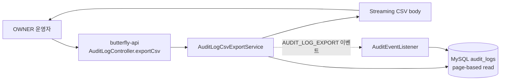
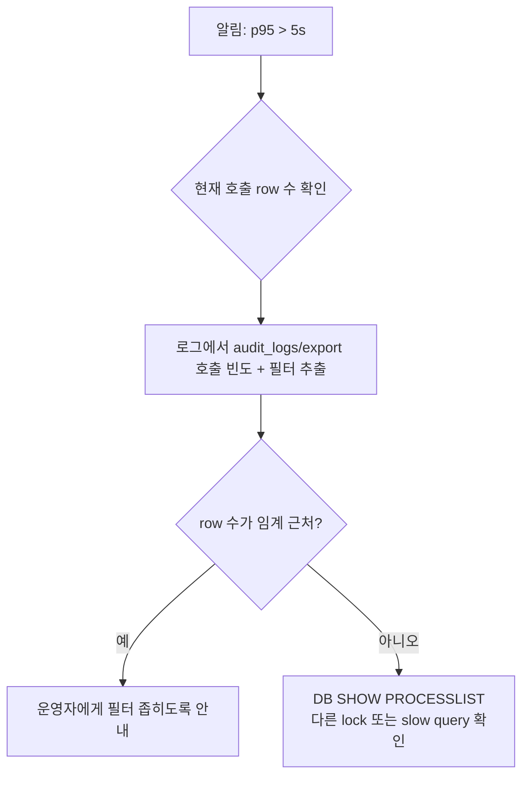

# 운영 인수 문서 — 감사 로그 CSV 내보내기 API

> **대상**: SRE / 온콜 / DBA / 컴플라이언스 (감사 데이터 반출 시점부터의 시스템 책임자)
> **시스템**: butterfly-api `/api/v1/audit-logs/export`
> **티켓**: [S14P31B101-91](https://ssafy.atlassian.net/browse/S14P31B101-91), [S14P31B101-35](https://ssafy.atlassian.net/browse/S14P31B101-35)
> **인수일**: 2026-05-07
> **소관 모듈**: butterfly-reporting (개발: 이재영)

---

## 1. 시스템 한 줄 요약

OWNER 권한 운영자가 audit_logs 테이블의 데이터를 RFC 4180 + UTF-8 BOM CSV로 내려받는 **읽기 전용 + self-audit 동반** API. 추가 마이그레이션·인프라 의존성 없음.



핵심:
- Read-only API + 응답 streaming (메모리 보호)
- 50,000 row 초과 시 즉시 거부 (비동기 후속)
- **본 API 호출 자체가 audit_logs에 기록됨** (compliance 증적)

---

## 2. SLA / 운영 기준

| 항목 | 정상 기준 | 경보 임계 |
|---|---|---|
| 응답 시간 (p95) | < 2s (10,000 row 기준) | > 5s (5분 지속) |
| 응답 시간 (p99) | < 5s (50,000 row 기준) | > 10s (5분 지속) |
| 5xx 에러율 | < 0.1% | > 1% (1분 지속) |
| `400 ANALYTICS_003` (50k 초과) | < 5% | > 20% (운영자가 임계를 자주 받는 신호 → UX 개선 또는 비동기 도입) |
| 임시 메모리 점유 | 페이지당 ~2MB (1000 row × 평균 2KB) | OOM 알림 시 임계 축소 |
| audit_logs 테이블 read latency (p95) | < 100ms | > 500ms |

본 API는 동기 streaming이라 응답 시간이 데이터 양에 비례한다. 30,000 row 이상이면 흐를 수도 있다 — 운영자 UI에서 진행 상태 표시 권장.

---

## 3. 의존 인프라

| 항목 | 의존 종류 | 영향 |
|---|---|---|
| MySQL `audit_logs` | 필수 read | 다운 시 5xx |
| MySQL `audit_logs` | 필수 write (self-audit) | listener INSERT 실패 시 self-audit만 누락 (응답은 정상) |
| Redis | 없음 | 본 API 미사용 |
| Kafka | 없음 | 본 API 미사용 |
| 다른 도메인 | 없음 | 독립 |

**가장 큰 위험**: audit_logs 테이블 자체. 본 API는 audit_logs를 read하면서 동시에 listener가 같은 테이블에 write한다. **트리거(append-only) 정책**이 정상 작동해야 한다.

---

## 4. 응답 헤더 / 본문 사양

### 4.1 정상 응답

```http
HTTP/1.1 200 OK
Content-Type: text/csv;charset=UTF-8
Content-Disposition: attachment; filename*=UTF-8''audit-logs-20260507-131800.csv
Cache-Control: no-store

[BOM 3바이트: EF BB BF]
auditId,projectId,memberId,action,targetType,targetId,ipAddress,userAgent,createdAt,detail
1,100,200,FCM_KEY_UPDATE,Project,100,127.0.0.1,test-agent,2026-05-01T12:00:00,"{""hashPrefix"":""a1b2c3d4""}"
...
```

- **BOM 필수**: Excel 한글 인식. 누락 시 한국어 Windows에서 한글 깨짐.
- **Cache-Control: no-store**: 감사 데이터 — 프록시/CDN 캐시 금지.
- **filename*=UTF-8'' RFC 5987 인코딩**: 한글/특수문자 파일명 호환.

### 4.2 에러 응답

| 상태 | code | 의미 |
|---|---|---|
| 400 | ANALYTICS_002 INVALID_DATE_RANGE | startDate > endDate |
| 400 | ANALYTICS_003 DATE_RANGE_TOO_LARGE | 매칭 row > 50,000 |
| 401 | (auth) | JWT 누락 |
| 403 | OWNER_REQUIRED | OWNER 권한 없음 |

에러 응답은 일반 JSON 응답 형식 (`ApiResponse.fail`).

---

## 5. 모니터링

### 5.1 필수 메트릭

> **현재 상태**: Micrometer 메트릭 노출은 본 PR에 포함 안 됨. 별도 티켓 권장.

| 메트릭 | 출처 | 임계 |
|---|---|---|
| `http_server_requests_seconds{uri="/api/v1/audit-logs/export"}` | Micrometer (TODO) | p95 > 5s |
| `http_server_requests_total{uri=...,status="5.."}` | 동일 | rate > 0.001 |
| `http_server_requests_total{uri=...,status="400",error="ANALYTICS_003"}` | 동일 | 빈도 > 1/min (UX 개선 신호) |
| `audit_log_export_rows_total` | (TODO) | 추출 총량 모니터링 |
| `audit_log_export_self_audit_failures_total` | (TODO) | > 0이면 즉시 알림 (compliance 위험) |

### 5.2 즉시 가용한 확인 방법

```bash
# 본 API 호출 빈도
docker logs butterfly-api 2>&1 | grep "audit-logs/export" | wc -l

# 응답 시간 분포 (응답 로그가 millis 포함 시)
docker logs butterfly-api 2>&1 | grep "audit-logs/export" \
  | awk '{print $NF}' | sort -n

# 50k 초과 거부 빈도
docker logs butterfly-api 2>&1 | grep "ANALYTICS_003"

# self-audit 발행 실패 (AFTER_COMMIT listener 예외)
docker logs butterfly-api 2>&1 | grep "AuditEventListener" | grep -i "error\|fail"
```

### 5.3 Compliance용 — 누가 언제 반출했는지 조회

`audit_logs` 자체가 답을 갖고 있다. SQL로 직접 조회:

```sql
SELECT created_at, member_id, ip_address, user_agent,
       JSON_EXTRACT(detail, '$.exportedCount') AS rows_exported,
       JSON_EXTRACT(detail, '$.filter') AS filter_used
FROM audit_logs
WHERE action = 'AUDIT_LOG_EXPORT'
ORDER BY created_at DESC
LIMIT 100;
```

또는 본 API로 self-recursion (`action=AUDIT_LOG_EXPORT` 필터)으로 조회·CSV.

---

## 6. 보안 / Compliance

### 6.1 응답에 노출되는 데이터

`audit_logs`의 모든 컬럼이 그대로 CSV에 포함:
- `auditId, projectId, memberId, action, targetType, targetId`
- `ipAddress, userAgent`
- `createdAt`
- `detail` (JSON — 변경 전/후 값, hash prefix 등)

**비밀값**: ADR-0008 §"비밀값 마스킹 규칙"에 따라 `detail`에는 평문 비밀값이 들어 있지 않다 (도메인 발행 시점에 SHA-256 해시 prefix만 저장). 본 API는 그대로 직렬화하므로 CSV 자체가 비밀 노출원이 되지 않는다.

**개인정보**:
- `ipAddress`, `userAgent` — PII 등급 중간. 응답 받은 측이 보안 관리 책임.
- `memberId` — 식별자만 (이름/이메일 join 없음).

### 6.2 권한

- OWNER만 호출 가능 (`@PreAuthorize`)
- 명세상 ADMIN도 가능해야 하지만 현 SpEL이 OWNER만 통과 — auth 모듈 합류 후 메서드 레벨 확장 예정 (S14P31B101-35 본 PR 잔여 항목)

### 6.3 감사 증적 (self-audit)

- 호출 자체가 `AUDIT_LOG_EXPORT` 액션으로 audit_logs에 기록됨
- 행위자 ID, IP, User-Agent, 필터 조건, 추출 row 수 모두 기록
- `AuditEventListener`가 AFTER_COMMIT에 INSERT
- 만약 listener INSERT가 실패하면 응답은 정상이지만 self-audit이 누락 — **compliance 위험**, 모니터링 필요

### 6.4 외부 공유 정책

운영자가 받은 CSV의 **외부 공유는 운영자 책임**. 다음 가이드 권장:
- 외부 공유 시 압축 + 암호 권장
- 30일 이내 분석/제출 후 폐기
- 본 시스템은 응답 후 서버 디스크에 임시 저장 안 함 (streaming response)

---

## 7. 장애 대응 런북

### 7.1 시나리오 — 응답이 느리거나 timeout



**Step 1 — 어떤 호출이 느린지 파악**:
```bash
docker logs butterfly-api 2>&1 | grep "audit-logs/export" | tail -50
```

**Step 2 — DB 쪽 부하 확인**:
```sql
SHOW FULL PROCESSLIST;

-- audit_logs 테이블 lock 상황
SELECT * FROM information_schema.innodb_lock_waits;
```

**Step 3 — 임시 mitigation**:
- 임계를 50k → 20k로 한시 축소: `MAX_SYNC_EXPORT_ROWS` 변경 (재배포 필요)
- 또는 본 endpoint에 rate limit 추가

### 7.2 시나리오 — 50k 초과 거부가 자주 발생

증상: `400 ANALYTICS_003`이 분당 여러 건.

원인 후보:
- 운영자가 큰 기간으로 자주 시도
- UI에서 시작 화면이 default로 큰 기간을 잡고 있음
- 진짜로 비동기가 필요한 시점

대응:
1. **단기**: UI에서 "기간이 너무 깁니다" 메시지 + 추천 기간 제시
2. **중기**: 임계 50k → 100k로 상향 (DB/메모리 측정 후)
3. **장기**: 비동기 202 Accepted 패턴 도입 (별도 티켓)

### 7.3 시나리오 — self-audit (AUDIT_LOG_EXPORT) 누락

**Compliance critical**. 즉시 대응.

```bash
# 본 API 호출 수
docker logs butterfly-api 2>&1 | grep "audit-logs/export" | grep " 200 " | wc -l

# AUDIT_LOG_EXPORT 자체 기록 수
docker exec -it butterfly-mysql mysql -uroot -p butterfly -e \
  "SELECT COUNT(*) FROM audit_logs WHERE action = 'AUDIT_LOG_EXPORT' AND created_at > NOW() - INTERVAL 1 HOUR;"
```

두 수치가 크게 차이 나면 self-audit 누락 발생. 원인:
- AuditEventListener 예외 (DB write 실패)
- 발행자 트랜잭션 commit 실패 (read-only 응답이라 거의 안 일어남)

조치:
1. 로그에서 `AuditEventListener` exception stack trace 확인
2. audit_logs 테이블 INSERT 권한 확인 (DB GRANT)
3. trigger가 INSERT를 막고 있는지 확인 (V3__audit_triggers.sql — INSERT는 허용해야 함)
4. 임시로 본 API 비활성화하고 근본 원인 해결

### 7.4 시나리오 — CSV 한글 깨짐 신고

원인: BOM 누락 또는 transport 중간 어딘가에서 BOM 제거.

확인:
```bash
curl -H "Authorization: Bearer $TOKEN" -H "X-Member-Id: 999" \
     "https://api.butterfly.com/api/v1/audit-logs/export?..." \
     -o test.csv

# BOM 확인 (첫 3바이트가 EF BB BF여야 함)
xxd test.csv | head -1
```

BOM이 없으면:
- 코드 변경 (`UTF8_BOM` 제거됐는지) 확인
- 응답 압축 미들웨어가 BOM을 떼었을 가능성 — `Content-Encoding` 헤더 확인
- CDN/프록시가 인코딩 변환했을 가능성

BOM이 있는데 깨지면:
- Excel 버전 별 호환성 차이. 신고자 환경 확인 권장.
- LibreOffice/Numbers는 추가 인코딩 옵션이 필요할 수 있음.

### 7.5 시나리오 — 무한 페이지 루프 의심

본 PR은 `page.hasNext()`가 false일 때 종료. 무한 루프는 코드 버그 또는 데이터 문제 시:
- count는 100인데 hasNext가 영원히 true → JPA bug 또는 데이터 동시 쓰기로 인한 page count 계산 오차

증상: 응답이 영원히 끝나지 않음.

조치:
1. timeout으로 강제 끊기
2. 로그에서 같은 endpoint 호출이 오래 잡혀 있는지 확인
3. 임시 mitigation: client에서 절단 후 재시도 금지
4. 코드 검토 (StreamPages 종료 조건)

---

## 8. 알려진 제약 / 후속 작업

| 항목 | 영향 | 후속 티켓 |
|---|---|---|
| 비동기 202 Accepted 미지원 | 50k 초과 시 거부 | 별도 티켓 (작업 큐 + 알림 인프라) |
| Micrometer 메트릭 미노출 | 모니터링이 access log 의존 | 별도 티켓 |
| 다른 리포트(34/92/90) CSV 미지원 | CsvWriter는 있지만 사용처는 audit만 | 각 리포트 티켓 진행 시 |
| ADMIN 권한 이름 미지원 (현재 OWNER만) | ADMIN이 본 API 못 씀 | auth 합류 시 메서드 레벨 확장 |
| 임시 다운로드 파일 1시간 자동 삭제 (명세 항목) | 본 PR은 streaming이라 파일 안 만듦 — 비동기 도입 시 의미 있음 | 비동기 후속과 함께 |
| 시계열 분할 다운로드 | 큰 기간을 자동으로 월별 파일로 쪼개기 — 미지원 | 부족 시 후속 |

---

## 9. 인수 시 점검 항목 (체크리스트)

### 9.1 사전 검증

- [ ] OWNER로 호출 시 200 + CSV 응답
- [ ] OWNER 외 권한으로 403
- [ ] startDate > endDate → 400 ANALYTICS_002
- [ ] 결과 50k 초과 케이스 → 400 ANALYTICS_003
- [ ] 응답 첫 3바이트가 UTF-8 BOM (xxd 확인)
- [ ] Content-Disposition 헤더의 filename 정상 (브라우저가 자동 다운로드)
- [ ] 한글 detail이 Excel에서 정상 표시

### 9.2 Self-audit 검증

- [ ] CSV 호출 후 audit_logs에 `action=AUDIT_LOG_EXPORT` row 추가
- [ ] detail에 filter, exportedCount 포함
- [ ] memberId, ipAddress, userAgent 정상 기록

### 9.3 모니터링

- [ ] (TODO) Micrometer 메트릭 추가
- [ ] DB read latency 모니터링
- [ ] self-audit 누락 알림 (CSV 호출 수 vs AUDIT_LOG_EXPORT row 수 비교)
- [ ] 50k 거부 빈도 알림 (UX 개선 트리거)

### 9.4 보안

- [ ] CSV 응답에 평문 비밀값 미포함 (detail 컬럼 샘플 검사)
- [ ] X-Forwarded-For 우선 처리되어 실제 클라이언트 IP 기록
- [ ] CDN/프록시 캐시 금지 (`Cache-Control: no-store`) 확인

### 9.5 운영 절차

- [ ] 본 런북 온콜 wiki 등록
- [ ] Compliance 팀과 self-audit 보존 정책 합의 (audit_logs retention)
- [ ] 운영자에게 "외부 공유 시 암호 권장" 가이드 전달

---

## 10. 비상 연락처

| 역할 | 담당 | 연락 |
|---|---|---|
| 본 API 개발 | 이재영 | woduddl1000@gmail.com |
| audit_logs append-only 트리거 | 이재영 (S14P31B101-125) | 동상 |
| MySQL 인프라 | infra 팀 | (운영 채널) |
| Compliance | (담당자) | (사내 채널) |

---

## 11. 변경 이력

| 일자 | 변경 | 작성자 |
|---|---|---|
| 2026-05-07 | 초안 작성 (S14P31B101-91 / S14P31B101-35 인수) | 이재영 |
