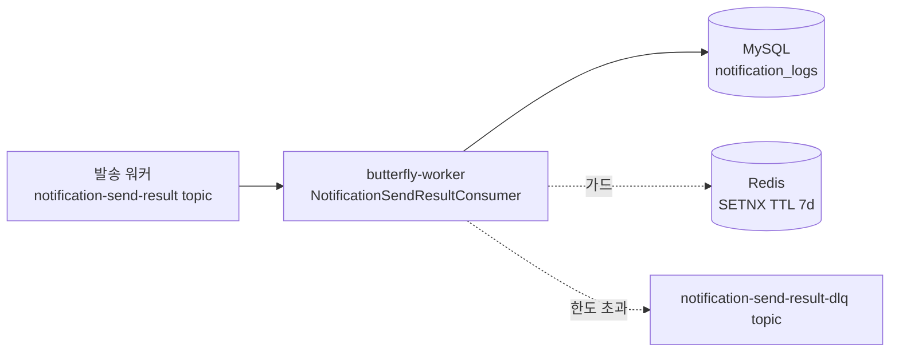
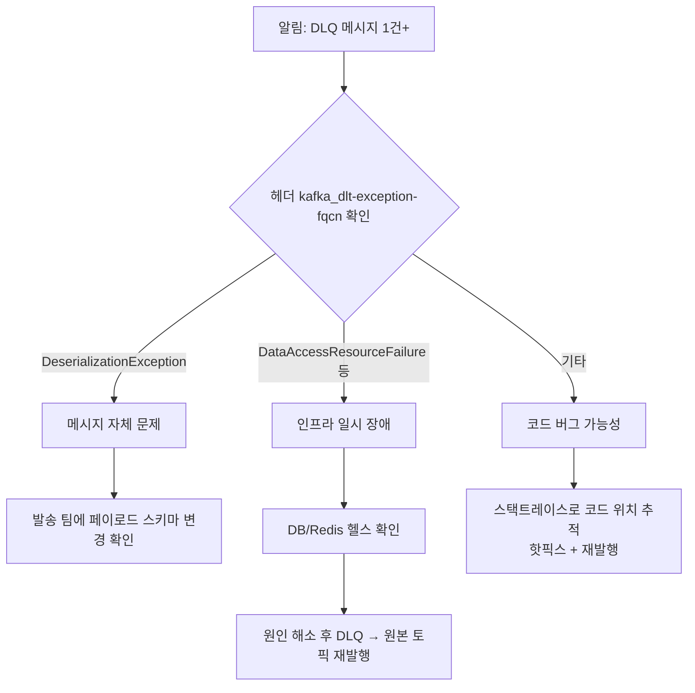

# 운영 인수 문서 — Kafka 컨슈머 DLQ + 재시도 (notification-send-result)

> **대상**: SRE / DBA / 온콜 담당자
> **시스템**: butterfly-worker (`notification-send-result` Kafka 컨슈머)
> **티켓**: [S14P31B101-180](https://ssafy.atlassian.net/browse/S14P31B101-180)
> **인수일**: 2026-05-07
> **소관 모듈**: butterfly-reporting (개발: 이재영)

---

## 1. 시스템 한 줄 요약

발송 워커(이서연/구동엽 팀)가 Kafka 토픽 `notification-send-result`로 발행한 발송 결과를 reporting 모듈이 소비해 `notification_logs` 테이블에 적재한다. 본 인수 대상은 그 컨슈머의 **DLQ + 지수 백오프 재시도 + Redis 보조 멱등성** 운영 안정성 기능이다.



---

## 2. SLA / 운영 기준

| 항목 | 정상 기준 | 경보 임계 |
|---|---|---|
| 컨슈머 lag | < 5초 | > 30초 (5분 지속) |
| 재시도 발생률 | < 0.1% / min | > 1% / min |
| DLQ 발행 수 | 0 / hour | > 0 / hour (즉시 알림) |
| Redis 가드 응답 | < 5ms p99 | > 50ms p99 |
| `notification_logs` INSERT | < 50ms p99 | > 500ms p99 |

DLQ에는 **메시지가 1건이라도 들어오면 즉시 알림 대상**이다. 정상 운영에서는 0이어야 한다.

---

## 3. Kafka 토픽 사양

### 3.1 원본 토픽 — `notification-send-result`

| 설정 | 권장 운영 값 | 설명 |
|---|---|---|
| Partitions | 3 (MVP) → 6 (10k msg/s 이상 시) | 컨슈머 parallelism 한계 |
| Replication factor | 3 | prod, 단일 장애 허용 |
| Retention | 7 days | Redis 가드 TTL과 정합 |
| Cleanup policy | delete | compact 사용 안 함 |
| Min in-sync replicas | 2 | 발행자 측 ack=all 가정 |

### 3.2 DLQ 토픽 — `notification-send-result-dlq`

| 설정 | 권장 운영 값 | 설명 |
|---|---|---|
| Partitions | 1 | 트래픽 매우 적음, 분석 용이성 우선 |
| Replication factor | 3 | 데이터 손실 금지 (감사 자료) |
| Retention | 30 days | 사후 분석을 위해 길게 |
| Cleanup policy | delete | |

**DLQ 토픽 사전 생성 권장**. 자동 생성도 동작하지만 partition/replication 설정이 broker default로 만들어지므로 prod에서는 사전 생성하여 위 설정 적용.

```bash
docker exec -it butterfly-kafka kafka-topics \
    --bootstrap-server localhost:9092 \
    --create \
    --topic notification-send-result-dlq \
    --partitions 1 \
    --replication-factor 3 \
    --config retention.ms=2592000000  # 30 days
```

---

## 4. 의존 인프라

### 4.1 Redis

| 항목 | 값 |
|---|---|
| 키 prefix | `notification-log:msg-key:` |
| 키 형식 | `notification-log:msg-key:<messageKey>` |
| 값 | `"1"` (placeholder, 의미 없음) |
| TTL | 7일 (`Duration.ofDays(7)`) |
| 작업 | SETNX(=`SET key val NX EX 604800`) + DEL (장애 시 release) |

**용량 추정**:
- 키 평균 60바이트 + 값 1바이트 + 메타 30바이트 ≈ 100바이트/키
- 1k msg/s × 86400s × 7d × 100B ≈ 약 60GB
- **사이징 가이드**: 트래픽 측정 후 Redis 메모리 1.5배 여유 권장
- maxmemory-policy: **`noeviction` 또는 `volatile-lru`** 권장 (`allkeys-lru`는 금지 — 가드 키가 임의 삭제되면 멱등성 깨짐)

**Redis 죽으면**: fail-open되어 모든 메시지가 DB UNIQUE 제약에 위임됨. **데이터 정확성은 유지되지만 DB 부하 증가**. 장기 장애 시 컨슈머 처리량 저하 가능.

### 4.2 MySQL — `notification_logs` 테이블

| 항목 | 값 |
|---|---|
| 컬럼 | message_key VARCHAR — UNIQUE 제약 (V13 마이그레이션) |
| 주요 INDEX | `uk_notification_logs_message_key` (UNIQUE) |
| 예상 row 증가율 | 발송량과 1:1 |

**UNIQUE 제약이 reporting 멱등성의 최종 방어선**이다. 운영 중 이 제약을 절대 제거하지 말 것.

---

## 5. 재시도 정책

```
초기 시도 (즉시) → 실패
  ↓ 1초 대기
재시도 1 → 실패
  ↓ 2초 대기
재시도 2 → 실패
  ↓ 4초 대기 (max 10초로 cap)
재시도 3 → 실패
  ↓ 한도 도달
DLQ 발행
```

| 파라미터 | 값 | 위치 |
|---|---|---|
| 초기 간격 | 1000ms | `NotificationKafkaConsumerConfig.notificationSendResultErrorHandler` |
| 배수 | 2.0 | 동일 |
| 최대 간격 | 10000ms | 동일 |
| 최대 누적 시간 | 20000ms | 동일 (실질 4회 attempt) |

**재시도 동안 같은 partition의 다른 메시지는 blocking됨** (DefaultErrorHandler 특성). 트래픽이 매우 높고 DB 장애가 잦으면 lag 누적 가능.

### 즉시 DLQ 행 예외 (재시도 없이 바로)

| 예외 | 의미 |
|---|---|
| `DeserializationException` | 메시지 자체 깨짐 (JSON 파싱 실패 등) |
| `IllegalArgumentException` | 코드 버그성 — 알리고 다음 메시지로 |
| `NullPointerException` | 코드 버그성 |

### 재시도 대상 예외 (인프라 일시 장애)

| 예외 | 의미 |
|---|---|
| `DataAccessResourceFailureException` | DB 커넥션 실패 |
| `CannotAcquireLockException` | DB lock 경합 |
| 기타 `RuntimeException` | 명시되지 않은 모든 케이스는 retry |

---

## 6. 모니터링

### 6.1 필수 메트릭 (Micrometer 기반, 별도 티켓에서 노출 예정)

> **현재 상태**: 메트릭 노출 코드는 본 PR에 없음. 운영 적용 전 별도 작업으로 추가 필요. 임시로는 로그 grep + Kafka admin tool로 확인.

| 메트릭 | 출처 | 임계 |
|---|---|---|
| `kafka_consumer_lag{topic="notification-send-result"}` | Kafka exporter / kafka-consumer-groups | > 30s |
| `notification_dlq_published_total` | (TODO) Micrometer counter | > 0 |
| `notification_consumer_retry_total` | (TODO) Micrometer counter | > 1% / min |
| `redis_guard_hit_total` / `redis_guard_total` | (TODO) | hit rate 모니터링용 |
| `redis_guard_failopen_total` | (TODO) | > 0이면 Redis 장애 알림 |

### 6.2 즉시 가용한 확인 방법 (메트릭 없이)

**컨슈머 lag 확인**:
```bash
docker exec -it butterfly-kafka kafka-consumer-groups \
    --bootstrap-server localhost:9092 \
    --group butterfly-analytics-notification-logs \
    --describe
```

**DLQ 메시지 수 확인** (offset 차이로):
```bash
docker exec -it butterfly-kafka kafka-run-class kafka.tools.GetOffsetShell \
    --broker-list localhost:9092 \
    --topic notification-send-result-dlq
```

**로그에서 재시도/DLQ 추적**:
```bash
# DLQ 발행 로그
docker logs butterfly-worker | grep "Dead-letter publication"

# 재시도 로그
docker logs butterfly-worker | grep "ListenerExecutionFailed"

# Redis 가드 fail-open 로그
docker logs butterfly-worker | grep "Redis guard fail-open"
```

---

## 7. 알림 (권장 설정)

| 알림 | 조건 | 채널 | 우선순위 |
|---|---|---|---|
| DLQ 메시지 발생 | DLQ topic offset 증가 | Slack #ops + Email | High |
| 컨슈머 lag 폭증 | lag > 30s 5분 지속 | Slack #ops | Medium |
| Redis 가드 fail-open | 로그 패턴 1분 5건+ | Slack #ops | Medium |
| 컨슈머 다운 | consumer group inactive | Slack #ops + PagerDuty | Critical |

---

## 8. 장애 대응 런북

### 8.1 시나리오 — DLQ에 메시지가 쌓이기 시작



### Step 1 — DLQ 메시지 헤더 분석

```bash
docker exec -it butterfly-kafka kafka-console-consumer \
    --bootstrap-server localhost:9092 \
    --topic notification-send-result-dlq \
    --from-beginning \
    --property print.headers=true \
    --max-messages 10 \
    --timeout-ms 5000
```

`kafka_dlt-exception-fqcn` 헤더로 원인 분류.

### Step 2 — 원인별 대응

| 원인 | 조치 |
|---|---|
| `DeserializationException` | 발송 팀과 페이로드 스키마 합의 재확인. 수정 PR 머지 전까지 DLQ 누적은 정상. |
| `DataAccessResourceFailureException` | MySQL 헬스 확인. RDS면 인스턴스 status, on-prem이면 `mysqladmin ping`. 회복 후 9.3절 재발행 절차. |
| `CannotAcquireLockException` | MySQL `SHOW ENGINE INNODB STATUS` 로 lock contention 분석. |
| 기타 | 스택트레이스 (`kafka_dlt-exception-stacktrace` 헤더) → 개발자 핸드오프 |

### Step 3 — DLQ → 원본 토픽 재발행 (수동)

**단순 재발행** (인프라 회복 후):
```bash
# kcat으로 DLQ 메시지 dump
kcat -b localhost:9092 -t notification-send-result-dlq -C -e \
    -f '%s\n' > dlq-payloads.json

# 원본 토픽으로 재발행
kcat -b localhost:9092 -t notification-send-result -P -l dlq-payloads.json

# DLQ topic offset 옮기기 (재발행 끝났으면 lag 정리)
docker exec -it butterfly-kafka kafka-consumer-groups \
    --bootstrap-server localhost:9092 \
    --group butterfly-analytics-notification-logs-dlq-reprocessor \
    --topic notification-send-result-dlq \
    --reset-offsets --to-latest --execute
```

**주의**: 재발행한 메시지는 Redis 가드(7일 TTL) 때문에 재차단될 수 있음. 만약 같은 messageKey로 다시 들어오는데 적재가 필요하다면, Redis 키를 먼저 삭제:
```bash
redis-cli DEL "notification-log:msg-key:<messageKey>"
```

### 8.2 시나리오 — 컨슈머 lag 폭증

| 가능 원인 | 진단 명령 | 대응 |
|---|---|---|
| DB 응답 느림 | `SHOW PROCESSLIST` | DB 튜닝, 일시 partition 추가 |
| 재시도 폭주 | 로그 `ListenerExecutionFailed` 빈도 | 원인 해결 후 lag 자연 회복 |
| 컨슈머 자체 다운 | `kafka-consumer-groups --describe` | worker 재시작 |
| Kafka 브로커 이슈 | `kafka-broker-api-versions` | infra 팀 핸드오프 |

### 8.3 시나리오 — Redis 장애

영향:
- 가드 fail-open → 모든 메시지가 DB까지 도달
- 중복 메시지가 DB에 도달해 UNIQUE 충돌 (정상 처리, no-op)
- DB 부하 증가 (얼마나? 평소 중복률 × 트래픽)

대응:
- **단기 (1시간 이내 회복 가정)**: 그대로 두고 Redis 복구 우선. 데이터 정확성은 유지됨.
- **장기 (1시간 초과)**: DB 부하 모니터링. 위험 수준이면 컨슈머 일시 정지 검토.

```bash
# 컨슈머 일시 정지 (worker 컨테이너 stop)
docker stop butterfly-worker

# Redis 복구 후 worker 재시작
docker start butterfly-worker
```

### 8.4 시나리오 — 발송 팀이 페이로드 스키마 변경 (사전 통보 없이)

증상: 갑자기 모든 메시지가 DLQ로 (`DeserializationException`).

대응:
1. **즉시**: 컨슈머는 정상 동작 (DLQ로 격리되어 다른 영향 없음). 알림으로 인지.
2. **분석**: DLQ 메시지 1건 dump → JSON 차이 확인.
3. **합의**: 발송 팀과 스키마 통일 (페이로드 record + `@JsonIgnoreProperties(ignoreUnknown=true)` 정책 재확인).
4. **수정**: 페이로드 record 업데이트 PR.
5. **재발행**: 머지 후 DLQ 메시지 원본 토픽으로 재발행.

---

## 9. 보안 / 데이터 거버넌스

### 9.1 DLQ에 들어가는 데이터

원본 메시지 페이로드 그대로. 즉 **개인정보(userId, deviceId)** 포함. DLQ 토픽 access는 원본과 동등하게 제한 필요:

- Kafka SASL/ACL: DLQ 토픽 read 권한은 운영자/온콜 그룹으로 한정
- 로그 dump 시: 외부 공유 금지, GitLab issue/Slack에 raw payload 첨부 금지

### 9.2 retention

DLQ retention 30일 = 30일 내 분석/재처리 책임. 30일 초과 시 메시지는 자동 삭제되며 데이터 손실로 간주.

### 9.3 Redis 키

`notification-log:msg-key:` 키 자체는 messageKey (UUID-like) 외 PII 없음. 다만 키 dump 시 messageKey와 추적 가능한 외부 시스템이 있다면 노출 위험 검토.

---

## 10. 인수 시 점검 항목 (체크리스트)

### 10.1 인프라

- [ ] DLQ 토픽 `notification-send-result-dlq` 사전 생성 (운영 환경)
- [ ] DLQ 토픽 retention 30일 설정 확인
- [ ] Redis maxmemory-policy `noeviction` 또는 `volatile-lru` 확인
- [ ] Redis 메모리 capacity 트래픽 측정 후 sizing
- [ ] MySQL `notification_logs.message_key` UNIQUE 제약 존재 확인 (V13 적용 확인)
- [ ] Kafka consumer group `butterfly-analytics-notification-logs` 생성/접근 권한

### 10.2 모니터링

- [ ] 컨슈머 lag 알림 (> 30s 5분 지속)
- [ ] DLQ 메시지 수 알림 (> 0)
- [ ] Redis 가드 fail-open 로그 알림
- [ ] (별도 티켓 후) Micrometer 메트릭 노출 + Grafana 대시보드

### 10.3 운영 절차

- [ ] 본 런북 (`operations_dlq_runbook.md`) 온콜 wiki 등록
- [ ] DLQ 재발행 도구 (kcat) 운영 서버에 사전 설치
- [ ] 발송 팀 (이서연/구동엽 팀)과 페이로드 스키마 변경 시 사전 합의 채널 합의

### 10.4 검증 (인수 전 1회)

- [ ] 스테이지에서 의도적 페이로드 망가뜨려 보고 DLQ 도달 확인
- [ ] 스테이지 DB 일시 stop → 재시도 후 정상 적재 확인
- [ ] DB 영속 stop → DLQ 도달 + Redis 가드 release 확인
- [ ] DLQ → 원본 토픽 재발행 절차 1회 실연

---

## 11. 알려진 제약 / 후속 작업

| 항목 | 영향 | 후속 티켓 |
|---|---|---|
| 메트릭 노출 미구현 | 모니터링이 로그 grep에 의존 | TBD |
| DLQ 자동 재처리 없음 | 운영자 수동 재발행 | TBD |
| ExponentialBackOff partition blocking | 재시도 동안 lag 누적 가능 | 트래픽 측정 후 RetryTopicConfiguration 전환 검토 |
| DLQ 토픽 자동 생성 의존 | broker default 설정으로 만들어짐 | 사전 생성 권장 (10.1 체크리스트) |
| Redis 사이징 미정 | 트래픽 측정 전이라 추정치만 있음 | prod 트래픽 측정 후 재산정 |

---

## 12. 비상 연락처

| 역할 | 담당 | 연락 |
|---|---|---|
| reporting 모듈 / 본 컨슈머 개발 | 이재영 | woduddl1000@gmail.com |
| 발송 워커 / 페이로드 스키마 | 이서연 / 구동엽 | (팀 연락처) |
| Kafka 인프라 | infra 팀 | (운영 채널) |
| MySQL 인프라 | infra 팀 / DBA | (운영 채널) |

---

## 13. 변경 이력

| 일자 | 변경 | 작성자 |
|---|---|---|
| 2026-05-07 | 초안 작성 (S14P31B101-180 인수) | 이재영 |
