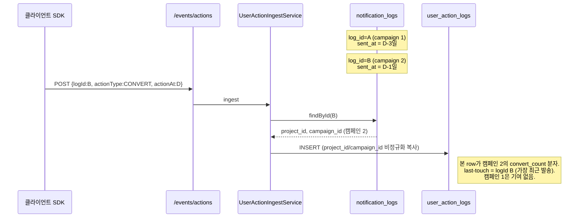
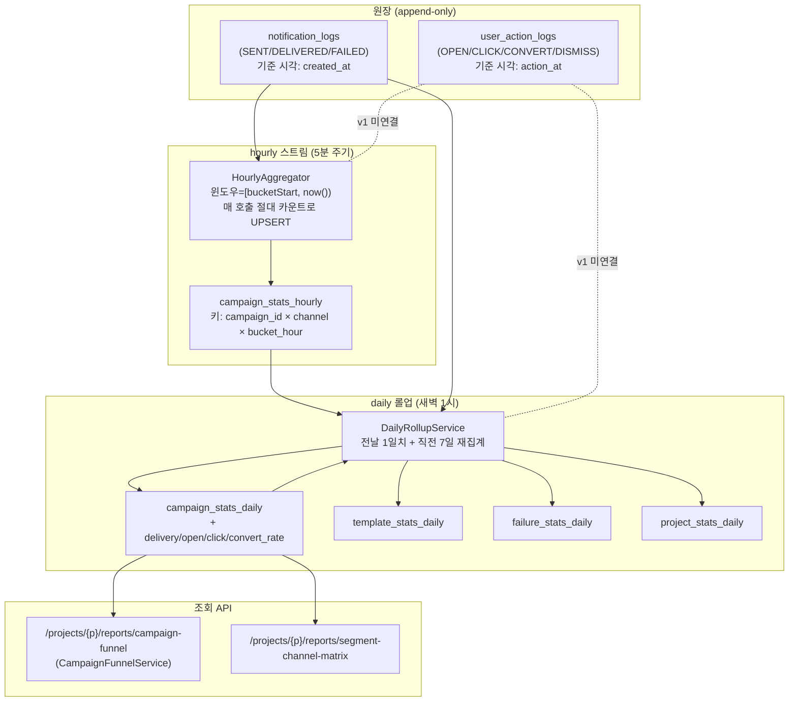

# Butterfly KPI 지표 정의서 & Attribution 기준

> Owner: 이재영
> 최초 작성: 2026-05-04
> 관련 Jira: `S14P31B101-76`
> 관련 ADR: [ADR-0007](../adr/0007-analytics-aggregation-tables-v2.md)
> 참조 스펙: [butterfly-reporting/SCHEMA_DESIGN.md](../../butterfly-reporting/docs/SCHEMA_DESIGN.md), [butterfly-reporting/butterfly_api_spec_v2.md](../../butterfly-reporting/docs/butterfly_api_spec_v2.md)

본 문서는 대시보드·리포트·집계 배치·API 응답이 **모두 같은 정의로 같은 숫자**를 보도록 KPI 계산 규칙을 고정한다. ADR-0007이 카운트와 비율 공식의 결정 근거를 담고 있다면, 본 문서는 그 결정을 구현·운영 측에서 참조하는 표준 문서다.

수정 시 ADR과 본 문서를 함께 갱신한다 — 한쪽만 바꾸면 팀마다 다른 숫자를 보게 된다.

---

## 1. 용어

| 용어 | 정의 |
|---|---|
| **발송(send)** | 발송 워커가 채널 게이트웨이에 전송을 시도해 `notification_logs` row가 생성된 시점. status 무관. |
| **도달(deliver)** | 채널 게이트웨이가 단말까지 전달을 confirm한 시점. `notification_logs.status='DELIVERED'`. |
| **오픈(open)** | 사용자가 메시지를 연 시점. `user_action_logs.action_type='OPEN'`. |
| **클릭(click)** | 사용자가 메시지 내 링크/CTA를 누른 시점. `user_action_logs.action_type='CLICK'`. |
| **전환(convert)** | 캠페인 의도 행동(구매/가입 등)이 완료된 시점. `user_action_logs.action_type='CONVERT'`. |
| **무시(dismiss)** | 사용자가 메시지를 명시적으로 닫거나 거부한 시점. `user_action_logs.action_type='DISMISS'`. KPI 분자에서는 사용하지 않으나 분석에 활용. |
| **회차(execution)** | 반복 캠페인의 1회 실행. `campaign_executions.campaign_execution_id`로 식별. 단발 캠페인은 NULL 허용. |
| **버킷(bucket)** | 집계 윈도우. `bucket_hour` (시간 단위) / `bucket_date` (일 단위 KST 자정 기준). |

**원칙**: 본 정의서가 ADR-0007과 충돌하면 ADR을 우선한다. 새 결정이 필요하면 ADR을 먼저 갱신하고 본 문서를 동기화한다.

### 1.1 전환(CONVERT) 이벤트 상세 정의

전환은 캠페인이 의도한 핵심 행동이 완료된 시점을 의미한다. 본 시스템에서 "전환"으로 인정되는 행동은 다음 조건을 **모두** 만족해야 한다:

1. **SDK가 `actionType=CONVERT`로 명시적 발행** — 자동 추정 없음. 클릭→체류→완료까지 묶어 자동으로 전환을 도출하지 않는다. 클라이언트(웹/앱/SDK)가 비즈니스 로직으로 "구매 완료/회원가입 완료/특정 행동 완료" 등을 판단해 직접 보낸다.
2. **부모 발송(`logId`)이 존재** — `notification_logs`에 해당 row가 있어야 한다. 없으면 `LOG_NOT_FOUND` (400)로 거부 (`UserActionIngestService#record`).
3. **attribution 윈도우(§4.2) 안에서 발생** — 발송 후 30일 안의 `actionAt`만 캠페인 기여로 인정.

#### 클라이언트 발행 계약

`POST /api/v1/events/actions` (butterfly_api_spec_v2.md #19) 페이로드:

```json
{
  "logId": 98234521,
  "userId": 78901,
  "deviceId": 23456,
  "actionType": "CONVERT",
  "actionTarget": "https://shop.example.com/order/complete?orderId=...",
  "userAgent": "Mozilla/5.0 ...",
  "actionAt": "2026-04-28T10:05:00.000Z"
}
```

- `logId` (필수): 전환을 유발한 발송의 식별자. SDK가 발송 수신 시 받아 둔 값을 그대로 사용.
- `actionAt` (필수): 전환 행동이 일어난 시각. 서버 수신 시각이 아니다 (지연 도착 허용 — §5).
- `actionTarget` (선택, 권장): 전환 페이지/상품 URL. 분석에서 전환이 일어난 컨텍스트를 추적할 때 사용. **현재 v1은 CLICK에서만 URL 검증을 강제하고, CONVERT는 검증 없이 그대로 적재**한다 (`UserActionIngestService.validateUrl`은 CLICK일 때만 호출).
- `userId` / `deviceId` (선택): 둘 중 하나는 있는 것이 권장. attribution 매칭은 `userId` 기준 (§4.5).

#### CONVERT 페이로드의 매출 필드

ADR-0007 / 본 문서 §3.3은 `revenue` 필드를 통한 매출 기여를 명시하나, **v1 스키마에는 `user_action_logs.revenue` 컬럼이 없다**. 현재 코드 경로상 매출 데이터는 적재되지 않으며, `attributed_revenue`/`revenue_per_message`/`roi`는 v1에서 산출하지 않는다. 빌링 도메인과의 인터페이스 합의 후 별도 마이그레이션과 ADR로 도입한다.

#### CONVERT가 아닌 것

- 단순 페이지 진입 (PV/세션) → 본 시스템 추적 대상 아님 (별도 PV 이벤트 시스템 권장)
- CTA 버튼 클릭만 → CLICK이지 CONVERT 아님 (구매 완료가 일어나야 CONVERT)
- 캠페인 메시지 없이 일어난 자연 전환 → `logId`가 없으므로 본 시스템 적재 불가 (organic 트래픽은 별도 분석)

---

## 2. 카운트 정의 (counter metrics)

모든 카운트는 **buckets × dimensions** 단위로 집계되며, 자연 키 UPSERT로 멱등성을 보장한다 ([ADR-0007](../adr/0007-analytics-aggregation-tables-v2.md)).

### 2.1 발송 단계 카운트 (`notification_logs` 기반)

| 카운트 | 정의 | SQL 의사코드 |
|---|---|---|
| `sent_count` | "발송 성공으로 채널 게이트웨이가 받은 건수" | `COUNT(*) WHERE status IN ('SENT','DELIVERED')` |
| `delivered_count` | "단말까지 도달이 confirm된 건수" | `COUNT(*) WHERE status = 'DELIVERED'` |
| `failed_count` | "발송 실패로 끝난 건수" | `COUNT(*) WHERE status = 'FAILED'` |
| `pending_count` | "아직 게이트웨이 응답을 못 받은 건수 — 운영 모니터링용" | `COUNT(*) WHERE status = 'PENDING'` |

**주의**: `sent_count`는 DELIVERED를 포함한다. "게이트웨이 단계까지 성공한 모집단" 의미라 일관성 있게 둔다 — DELIVERED는 SENT의 후속 상태이므로 SENT를 거쳐 갔다.

### 2.2 사용자 반응 카운트 (`user_action_logs` 기반)

| 카운트 | 정의 | SQL 의사코드 |
|---|---|---|
| `open_count` | OPEN 이벤트 총수 | `COUNT(*) WHERE action_type = 'OPEN'` |
| `click_count` | CLICK 이벤트 총수 | `COUNT(*) WHERE action_type = 'CLICK'` |
| `convert_count` | CONVERT 이벤트 총수 | `COUNT(*) WHERE action_type = 'CONVERT'` |
| `dismiss_count` | DISMISS 이벤트 총수 | `COUNT(*) WHERE action_type = 'DISMISS'` |

### 2.3 unique vs total

기본 카운트는 **total**(이벤트 row 수). 분석에서 "고유 사용자 수"가 필요한 경우 `_unique` 접미사를 붙여 별도 컬럼/응답 필드로 제공한다.

| total | unique |
|---|---|
| `open_count` = `COUNT(*)` | `open_unique` = `COUNT(DISTINCT user_id)` |
| `click_count` = `COUNT(*)` | `click_unique` = `COUNT(DISTINCT user_id)` |
| `convert_count` = `COUNT(*)` | `convert_unique` = `COUNT(DISTINCT user_id)` |

집계 테이블 5종(ADR-0007)은 v1에서는 **total만 보유**하고, unique는 후속 요구가 들어오면 컬럼 추가 + 재집계로 도입한다. v1 비율 지표는 모두 total 기반이다.

`user_id IS NULL`인 익명 이벤트는 unique 계산에서 **각 row를 별개로 취급하지 않고 제외**한다. 익명 분석은 다른 식별자(device_id 등)로 별도 지표를 만들 때 다룬다.

### 2.4 회차·캠페인 식별 일관성

집계 시 **다음을 한 단위(row)로 묶지 않는다**:
- 한 캠페인의 서로 다른 회차(`campaign_execution_id` 다름) — `campaign_stats_hourly`/`campaign_stats_daily`는 캠페인 단위이고 회차 드릴다운은 `notification_logs` 원장에서 본다 (ADR-0007 결정).
- 같은 캠페인의 PUSH/EMAIL — `channel`이 자연 키에 포함된다.

회차 단위 비교가 필요한 분석 화면은 `campaign_stats_hourly`를 회차의 시간 윈도우로 슬라이스해서 본다.

---

## 3. 비율 지표 (rate metrics)

### 3.1 표준 공식

```
delivery_rate = delivered_count / sent_count       × 100
open_rate     = open_count      / delivered_count  × 100
click_rate    = click_count     / open_count       × 100
convert_rate  = convert_count   / sent_count       × 100
```

**분모가 0이면 NULL** (0%로 표시하면 "0%인지 데이터 부재인지" 구분 불가). API 응답에서도 `null`로 내려보내고 UI에서 "—" 등으로 표기한다.

### 3.2 click_rate 분모를 open으로 둔 이유

이메일 업계 표준은 `click / delivered`(CTR)를 쓰지만 푸시·앱 메시지는 "사용자가 본 후 행동했는가"가 더 의미 있다. 본 시스템은 다채널이고 푸시 비중이 큼 — `click / open` 표준을 채택한다 (ADR-0007 §"비율 지표 공식 (v2)").

이메일 전용 분석에서 CTR이 필요하면 응답에 별도 필드로 추가한다 — 표준 비율을 변경하지 않는다.

### 3.3 매출 기여도 (revenue attribution)

매출 기여 지표는 v1에서는 다음만 확정한다 — 정교한 multi-touch attribution은 v2 이후에 검토.

| 지표 | 정의 |
|---|---|
| `attributed_revenue` | 본 캠페인이 last-click attribution으로 받은 매출 합계 (3.4의 윈도우 안에서) |
| `revenue_per_message` | `attributed_revenue / sent_count` |
| `roi` | `(attributed_revenue - cost) / cost`. cost 정의는 외부 시스템(빌링) 의존이므로 v1 미산출, 응답 필드만 둠 |

매출 데이터는 외부 이벤트(`CONVERT` payload의 `revenue` 필드)로 들어오며 본 모듈은 합산만 한다. 정확한 정의는 외부 팀과 합의 후 추가 ADR로 확정한다.

---

## 4. Attribution 기준

attribution은 "어떤 캠페인이 사용자의 행동을 유발했는가"를 결정하는 규칙이다. 같은 사용자가 여러 캠페인을 받은 경우 어느 쪽에 기여를 줄지 결정해야 한다.

### 4.1 attribution 모델

v1: **last-touch within window**. 사용자가 캠페인 메시지를 받은 후 정해진 윈도우 안에 행동(OPEN/CLICK/CONVERT)하면 **그 시각으로부터 가장 가까운 직전 발송**이 기여를 받는다.

v2 이후: multi-touch (linear, time-decay 등)는 ADR로 별도 결정.

### 4.2 attribution window

| 행동 | 윈도우 | 정당성 |
|---|---|---|
| **OPEN** | 발송 후 **7일** | 푸시 알림은 며칠 뒤에도 잠금화면에서 발견될 수 있다. 7일이 통상 기준. |
| **CLICK** | 발송 후 **7일** | OPEN과 동일 윈도우. 보통 OPEN 이후 발생하므로 OPEN의 윈도우를 따라간다. |
| **CONVERT (구매·가입)** | 발송 후 **30일** | 구매 의사결정은 며칠 걸릴 수 있어 OPEN/CLICK보다 길게 잡는다. 업계 표준 30일. |
| **DISMISS** | 발송 후 **24시간** | 단순 무시 행동은 즉각적이라 단기 윈도우만 의미. KPI 분자 아님. |

윈도우는 **발송 시각 기준**이고 사용자 액션이 그 안에 들어와야 attribution 후보가 된다.

### 4.3 last-touch 결정 절차

같은 사용자가 윈도우 안에서 여러 캠페인을 받은 경우:

1. 액션 시각(`action_at`)을 기준으로
2. 그보다 이른 발송(`notification_logs.sent_at`) 중
3. 본인(`user_id` 일치)에게 가는 것 중
4. 액션 종류에 맞는 윈도우 안에 있는 것 중
5. **가장 최근(`sent_at`이 가장 큰)** row가 attribution 대상.

해당 발송이 둘 이상 있어 동시각이라면 `log_id`가 큰 쪽(나중에 INSERT된 쪽)을 선택한다 (deterministic tie-break).

### 4.4 channel 영향

같은 사용자가 PUSH와 EMAIL을 모두 받은 경우 channel 구분 없이 last-touch만 본다 — 사용자 입장에서는 "어떤 캠페인이 마지막으로 와닿았는가"가 의미 있다. channel별 효과 비교는 별도 지표(`campaign_stats_*` channel 차원)에서 다룬다.

### 4.5 익명·로그인 머지

발송 시점에는 `user_id`가 있지만 액션 시점에는 익명 device로만 들어올 수 있다 — 푸시 토큰 만료, 비로그인 클릭 등. v1은 다음 정책:

- `user_action_logs.user_id`가 있으면 그것을 기준으로 attribution 매칭
- `user_id IS NULL`이면 attribution 매칭에서 제외하고 raw 카운트만 잡는다 (별도 표시 없음)
- 익명 ↔ 로그인 사용자 ID 머지(`S14P31B101-97`)가 적용되면 그 이후 액션은 매칭됨

**소급 적용 안 함** — 머지 시점 이후 액션만 영향. 과거 익명 액션을 머지로 재분류하면 집계가 흔들리므로 운영 정책 차원에서 거부.

---

## 4-bis. attribution 결정 시퀀스 (참고)

같은 사용자에게 두 캠페인이 발송된 뒤 한 번의 CONVERT가 들어왔을 때 last-touch가 어떻게 결정되는지 시각화.



핵심: **클라이언트가 보낸 `logId` 자체가 last-touch 결정**이다. 서버가 사용자별 발송 이력을 뒤져 가장 최근 발송을 찾는 매칭 로직은 v1에 없다 — SDK가 "이 메시지에 대한 반응"이라는 컨텍스트로 발행하는 책임을 진다. 따라서 §4.3의 "가장 최근 sent_at 선택"은 **SDK 측 책임**이고, 서버는 받은 logId를 그대로 신뢰한다.

이 경계는 v2 multi-touch attribution을 도입할 때 서버 측 매칭으로 옮겨야 한다 (§8 후속 작업).

---

## 5. 지연 이벤트 처리

### 5.1 지연(late-arriving) 이벤트 정의

집계 배치가 이미 돌아간 버킷에 속하는 이벤트가 나중에 도착하는 경우. 예: SDK 오프라인 → 다음 날 온라인 시 일괄 발송. 액션 시각은 어제지만 INSERT는 오늘.

### 5.2 v1 정책

- **action_at(이벤트 발생 시각)을 기준**으로 집계한다 (created_at 아님). 지연 도착해도 원래 시각의 버킷으로 계산.
- 매 daily 배치는 **직전 7일**(D-1 ~ D-7) 버킷을 재집계한다 (ADR-0007 §"daily 롤업").
- 7일 이후 도착한 이벤트는 카운트되지 않는다 — 운영 로그 + DLQ로 모니터링하고, 다량 발생 시 별도 운영 도구로 backfill.

### 5.3 attribution window vs 재집계 윈도우

attribution 윈도우(최대 30일, CONVERT)와 재집계 윈도우(7일)가 다르다는 점에 주의. 30일 attribution을 받는 CONVERT가 8일 늦게 도착하면 카운트는 보강되지 않는다. 운영상 허용 가능한 손실로 본다 (정밀 backfill이 필요하면 후속 티켓에서 도구화).

### 5.4 hourly 스트림 정책

5분 주기 hourly 워커는 **직전 1시간**만 처리한다 — 지연 이벤트는 daily 재집계에서 흡수.

hourly 응답이 자정 직후 잠시 비어 있을 수 있다 (당일 누적이 아직 안 쌓임) — 대시보드는 "당일 누적 = hourly + 어제 daily" 같은 합성을 하지 않고, 시간대별 추이 화면 전용으로 사용한다.

---

## 5-bis. 집계 단위 흐름 (raw → hourly → daily)

원장(raw) 테이블 2종이 5분 hourly 워커와 새벽 daily 롤업을 거쳐 5종 집계 테이블로 흘러간다.



### 5-bis.1 단계별 책임

| 단계 | 입력 | 출력 | 빈도 | 멱등성 |
|---|---|---|---|---|
| **hourly 스트림** | `notification_logs` (`created_at` 윈도우) | `campaign_stats_hourly` | 5분 | UPSERT (`= VALUES(...)` 덮어쓰기) — 같은 bucket 재호출이 누적되지 않음 |
| **daily 롤업 — campaign** | `campaign_stats_hourly` (날짜 GROUP BY) | `campaign_stats_daily` (비율 포함) | 매일 01:00 | UPSERT, force=true 시 해당 날짜 row 삭제 후 재집계 |
| **daily 롤업 — template** | `notification_logs` (`created_at` 날짜 윈도우) | `template_stats_daily` | 매일 01:00 | UPSERT |
| **daily 롤업 — failure** | `notification_logs` (FAILED만) | `failure_stats_daily` | 매일 01:00 | UPSERT |
| **daily 롤업 — project** | `campaign_stats_daily` (project GROUP BY) | `project_stats_daily` | 매일 01:00 | UPSERT |

### 5-bis.2 비율 지표 산출 위치

§3의 `delivery_rate`/`open_rate`/`click_rate`/`convert_rate`는 **daily 롤업 단계**에서 SQL `CASE WHEN denom = 0 THEN NULL ELSE ROUND(...)` 로 계산되어 `campaign_stats_daily` 컬럼에 미리 들어간다 (`CampaignStatsDailyRepository.upsert`). 조회 API는 분모 0 처리를 다시 하지 않는다.

펀널 API(`CampaignFunnelService`)는 **단계간 통과율**을 응답 시점에 다시 계산하며, 같은 분모 0 → null 정책을 `ratePercent` 메서드에서 적용한다.

### 5-bis.3 hourly와 daily의 정합성 보장

- 같은 날짜에 대해 hourly가 12 × 24 = 288번 UPSERT한 결과가 daily 롤업 시 24개 hourly row로 SUM되고, 이것이 daily 1 row가 된다.
- hourly의 "매번 절대 카운트로 덮어쓰기" 정책 덕에 같은 bucket의 마지막 호출 결과가 살아남고, 그것이 daily 롤업의 입력이 된다.
- hourly 워커가 5분 SLA를 넘기면 lag로 누적되어 마지막 5분치가 누락될 수 있으나, daily 새벽 배치 + 직전 7일 재집계가 따라잡는다 (§5.2).

---

## 6. 운영 표준

### 6.1 시간대

모든 `bucket_*` 컬럼과 attribution 계산은 **KST(`Asia/Seoul`)** 기준이다. DB는 UTC로 저장하더라도 application 레이어에서 KST로 변환해 버킷팅한다.

UTC 기준이 필요한 외부 연동(SDK 이벤트 등)은 진입 시점에 KST로 변환 후 적재한다.

### 6.2 응답 정밀도

- 카운트: 정수
- 비율: 소수점 둘째 자리까지 (예: `93.47`). 반올림 (HALF_UP).
- 비율 분모가 0: `null`
- 매출: 정수(원). 부동소수점 사용 금지.

### 6.3 신규 KPI 추가 절차

1. ADR에 결정 근거 추가
2. 본 문서(`kpi-and-attribution.md`) 갱신
3. 집계 테이블 컬럼 추가 마이그레이션
4. 카운트/비율 코드 + 단위 테스트
5. API 응답 스키마 갱신

순서를 어기면 정의와 구현 간 drift가 발생한다.

---

## 7. 알려진 한계와 후속 작업

본 정의서가 명문화한 규칙과 v1 구현 사이에 다음 갭이 존재한다. 운영자/대시보드 사용자가 숫자를 해석할 때 반드시 인지해야 한다.

### 7.1 user_action_logs → 집계 테이블 미연결 (S14P31B101-40 시점)

`campaign_stats_hourly`의 `open_count` / `click_count` / `convert_count` 컬럼은 **현재 항상 0이 적재**된다.

- 원인: `CampaignStatsHourlyRepository.upsert` native 쿼리가 해당 컬럼에 `0` 리터럴을 박아 INSERT한다 (티켓 124-A의 의도된 v1 스텁).
- 영향:
  - `campaign_stats_daily`의 open/click/convert 카운트 — hourly에서 SUM(0) → 0
  - 결과적으로 `open_rate` / `click_rate` / `convert_rate` 모두 0 또는 `null`
  - `CampaignFunnelService` 응답의 OPEN/CLICK/CONVERT 단계가 0
- 원장(`user_action_logs`) 자체는 정상 적재되므로 raw 카운트 쿼리는 정확. 집계 테이블만 0.
- 해소 시점: `HourlyAggregator`/`DailyRollupService`가 `user_action_logs`를 `action_at` 윈도우로 GROUP BY해 hourly UPSERT에 함께 넣도록 확장하는 후속 티켓에서 (124-A 주석 참조).

### 7.2 attribution 매칭 위치 — 서버 vs 클라이언트

§4의 last-touch 결정 절차는 "서버가 사용자별 발송 이력을 뒤져 가장 최근 발송을 선택"하는 것처럼 읽힌다. **현재 v1은 그렇게 동작하지 않는다.**

- 실제 동작: `UserActionIngestService#record`는 클라이언트가 보낸 `logId`를 그대로 신뢰해 부모 발송으로 삼고, 그 발송의 `project_id`/`campaign_id`를 비정규화 복사해 INSERT한다. 같은 사용자의 다른 발송과 비교하지 않는다.
- 즉 **last-touch 선택의 책임은 SDK 측**에 있다 — SDK가 어떤 메시지에 대한 반응인지 결정하고 그 `logId`로 보낸다.
- §4.3의 "가장 최근 sent_at 선택" 절차는 v1에서 **검증·재계산되지 않는 명세**다. SDK가 잘못 보내면 attribution도 잘못된다.
- 후속: 서버 측 매칭(같은 user_id의 발송을 윈도우 안에서 탐색)을 도입하려면 `user_action_logs.log_id`를 NULL 허용으로 바꾸고 매칭 배치를 별도 도입해야 한다 — multi-touch 도입과 함께 ADR로 결정.

### 7.3 매출(revenue) 미적재

§3.3의 `attributed_revenue` / `revenue_per_message` / `roi`는 **v1에서 산출되지 않는다**.

- `user_action_logs` 스키마에 `revenue` 컬럼 없음 (`UserActionIngestRequest`에도 필드 없음).
- CONVERT 페이로드에서 매출 데이터를 받을 통로 자체가 닫혀 있다.
- 후속: 빌링 도메인 인터페이스 합의 → 컬럼 추가 마이그레이션 → 수신 DTO 확장 → 집계 합산 로직 → 응답 스키마.

### 7.4 attribution 윈도우 자체의 강제 미적용

§4.2의 7일 / 30일 / 24시간 윈도우는 **현재 어디에서도 강제되지 않는다**.

- `UserActionIngestService`는 `actionAt`이 발송 후 며칠 지났는지 검사하지 않는다.
- 집계 쿼리는 `actionAt` 절대 시각으로 GROUP BY할 뿐, "발송 후 N일 안인가"를 따지지 않는다.
- 즉 발송 후 100일 뒤 도착한 CONVERT도 그대로 카운트된다. 단, §5.2의 "직전 7일 재집계" 윈도우 밖이므로 늦게 도착하면 집계에는 못 들어간다 — 결과적으로 7일 휴리스틱이 사실상의 attribution 윈도우로 동작한다.
- ADR-0007 §"Post-MVP 개선 포인트"에도 같은 한계가 명시되어 있다.
- 후속: 윈도우 검증을 ingest 시점 또는 집계 단계에서 강제하려면 `notification_logs.sent_at`과의 차이 계산이 필요. 데이터 손실 vs 정확성 trade-off 결정 후 적용.

### 7.5 비율 지표가 hourly 단계에 없음

§3의 비율 4종은 `campaign_stats_daily`에만 컬럼이 있고 `campaign_stats_hourly`에는 없다.

- hourly 응답으로 비율을 보려면 호출자가 카운트로부터 직접 계산해야 한다 (분모 0 → null 정책 동일 적용).
- 시간대별 추이 화면이 비율을 그릴 때 라이브러리 측에서 NaN 처리가 누락되지 않도록 주의.

### 7.6 "DELIVERED 자동 진입" 가정

§2.1 "sent_count는 DELIVERED를 포함한다 — DELIVERED는 SENT를 거쳐 갔다"는 가정은 **status 전이 모델에 의존**한다 (SCHEMA_DESIGN.md §"상태 전이").

- 가정 깨짐 시나리오: 발송 워커가 `PENDING → DELIVERED` 직접 전이를 일으키는 경우.
- 현 스키마는 이 전이를 막지 않으므로 워커 구현 검증이 필요. 회귀 테스트가 status 전이 invariant를 검증하지 않으면 sent_count 정의가 무너진다.

### 7.7 unique 카운트 미보유

§2.3 `_unique` 시리즈는 v1 컬럼에 없다. "한 사용자가 푸시 5번 클릭"이 click_count=5로 잡힌다.

- 분석 화면에서 "고유 클릭자 수"가 필요해지면 컬럼 추가 + 재집계 마이그레이션이 필요.
- 익명 분석(`device_id` 기반)은 별도 트랙 — `user_id IS NULL` 처리(§2.3, §4.5)와 정책이 다름.

### 7.8 본 PR(S14P31B101-40) 후속 권장 티켓

1. **user_action_logs 집계 와이어업** — `HourlyAggregator`에 user_action_logs GROUP BY 추가. CampaignStatsHourlyRepository.upsert 시그니처에 open/click/convert 파라미터 노출. 124-A 후속.
2. **attribution 윈도우 강제** — ingest 또는 집계 단계에서 `actionAt - sent_at > windowDays` row를 분리(별도 카운트) 또는 거부.
3. **revenue 적재 경로** — DTO/스키마/집계 확장. 빌링 인터페이스 합의 선행.
4. **본 정의서 ↔ ADR-0007 동기화** — ADR §"Post-MVP 개선 포인트"가 "현재는 윈도우 미도입"이라 적혀 있는데 본 정의서 §4.2가 이미 윈도우를 명시했다. 후속 PR에서 ADR을 갱신해 정합성 회복.

---

## 8. 변경 이력

| 일자 | 내용 | 출처 |
|---|---|---|
| 2026-05-04 | 최초 작성 (S14P31B101-76) — ADR-0007의 카운트/비율을 정착, attribution 기준 신설 | 본 PR |
| 2026-05-07 | 전환(CONVERT) 이벤트 의미·SDK 발행 계약 명시(§1.1), attribution 결정 시퀀스 다이어그램(§4-bis), 집계 단위 흐름 다이어그램·단계별 책임표(§5-bis), 알려진 한계 7건 + 후속 권장 티켓(§7) 추가 | S14P31B101-40 |
